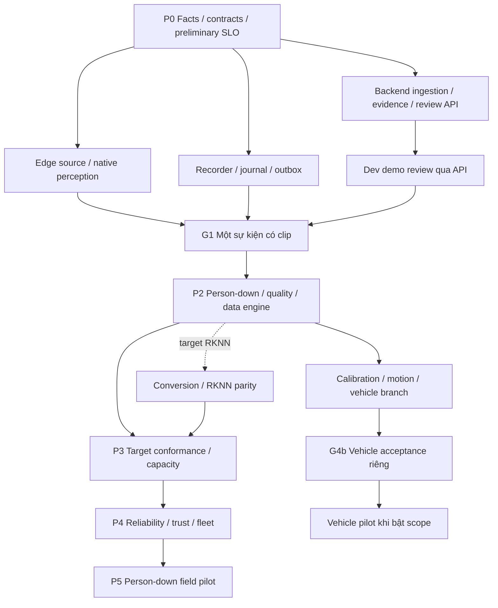

# Plan xây dựng hệ thống AI Camera giao thông

**Ngày:** 2026-10-11. **Trạng thái:** Thiết kế/backlog đã được duyệt và cập nhật theo review; tracker slices là đơn vị thực thi. Chưa triển khai runtime, chưa có nghiệm thu hardware. Facts, targets theo site và quyết định production được xử lý ở các gate tương ứng.

Nguồn chuẩn: [kiến trúc hệ thống](system-architecture.md), [deployment readiness](deployment-readiness.md), [hợp đồng tích hợp](contracts.md) và [tracker thực thi](../../.scratch/system-build-slices/PRD.md). [Mục lục docs](../README.md) xác định nguồn chuẩn; log/research không ghi đè thiết kế hiện hành. Các đường dẫn source dưới đây là vị trí dự kiến, chỉ tạo khi task tương ứng bắt đầu.

## 1. Kết quả cần xây và phạm vi

Xây một luồng hoàn chỉnh: nguồn video → perception → sự kiện nghi ngờ → clip gốc có provenance → lưu bền vững tại edge → gửi server → người trực review. Person-down là use case đầu; tai nạn xe là nhánh sau khi person-down đạt gate. Sự kiện AI, quyết định review và trạng thái evidence độc lập.

Đơn vị triển khai ban đầu là một camera và một edge. Sau khi có benchmark mới mở rộng số camera; 1–4 camera, 1080p và 10–15 analysis FPS trong báo cáo nghiên cứu là workload mong muốn để thử, chưa phải capacity được chấp nhận. Không dùng throughput inference riêng để ký capacity cả hệ thống.

Không implement đồng thời nhiều detector/backend, không tạo tất cả ports/folders từ đầu. Không thêm ANPR, nhận diện danh tính, chẩn đoán y khoa hoặc tự động điều phối cứu hộ vào scope này.

### 1.1 Những quyết định giữ nguyên

| Quyết định từ thiết kế | Hệ quả cho plan |
|---|---|
| C++ hot path; Python domain/control | Python reference là oracle; deployment path không truyền pixels mỗi frame qua Python |
| Recorder riêng và sở hữu upstream độc lập analytics | Phải chứng minh bằng kill/hang test; process riêng nhưng upstream nằm trong analytics vẫn trượt gate |
| Observation missing khác negative | FSM, pose scheduler, quality và UI đều phải biểu diễn unknown/degraded |
| Local durable journal/outbox | Event và intent gửi cùng transaction; ACK metadata/clip tách riêng |
| Raw evidence giữ nguyên | Proxy/redaction/overlay là derived artifact có lineage |
| Semantic contracts dùng chung các backend | Đổi backend phải qua conformance và event regression |
| Human review | Không suy operator confirmation thành AI confidence hoặc chẩn đoán |

### 1.2 Quyết định đã xác nhận và các nhánh còn mở

| ID | Quyết định | Đã xác nhận | Phần bị ảnh hưởng |
|---|---|---|---|
| Q1 | Baseline trước khi chốt board | ONNX để test luồng trên x86, Raspberry Pi hoặc board có runtime hỗ trợ; RKNN tối ưu sau khi chọn board | Decoder, SDK, artifact, benchmark và BOM; G1 không bắt buộc board đích/hardware decode |
| Q2 | Event ring hay NVR nhiều ngày | Event ring + giữ clip sự kiện cho bản đầu | Capacity storage, retrieval, UI playback |
| Q3 | Server lab | Một server nội bộ; production deployment chốt trước pilot | Provisioning, object store, network, credentials |
| Q4 | Phân kỳ native và thay engine | Tracker C++ ở P1, pose native ở P2; RKNN ở P3 khi chọn target; giữ tương thích đầu vào/đầu ra semantic | Native/Python contracts, adapters, conformance và regression |
| Q5 | Pipeline theo tính năng | Mỗi tính năng cảnh báo là pipeline riêng, có thể register thêm | Registry, lifecycle/state/config riêng; chia sẻ perception theo Q9 |
| Q6 | Evidence lab và mở rộng delivery | Pre/post 10/20 giây, ring 10 phút, server clips 7 ngày, outage budget 24 giờ; có điểm mở rộng phát event qua Kafka/RabbitMQ/WebSocket sau này | Storage budget, outbox/transport contract; chưa triển khai broker |
| Q7 | Review lab | Một vai trò reviewer; list/detail/playback, confirmed/false_positive/resolved; event hiển thị trước khi clip xong; chưa gửi notification ngoài dashboard | W01, UI01/UI02 |
| Q8 | Đổi inference engine | Qua config lúc startup/restart analytics; recorder tiếp tục; không cần hot-swap mỗi frame | B02/B03, engine manifests và conformance |
| Q9 | Mức tách pipeline | Logic/state/config riêng; chia sẻ source/detector/tracker/pose khi tương thích; chỉ tách process khi cần fault/resource isolation | O01/O02, capability routing và lifecycle |
| Q10 | Vị trí publisher mở rộng | Edge→server dùng HTTPS; server durable-commit event trước rồi phát downstream qua outbox/EventPublisher | S01/W02; Kafka/RabbitMQ/WebSocket chỉ là future adapters |
| Q11 | Scope đầu tiên | Person-down trước, một camera cố định và ROI lòng đường; vehicle pipeline làm sau | F02, I01–I05, G1/G2 |
| Q12 | Quota cạn | Bảo vệ pinned/unACK evidence; dọn dữ liệu được phép; vẫn thiếu thì degraded + evidence partial/failed, metadata/outbox có reserve riêng | R04/R05/J01/H01; không tự xóa unACK sau 24 giờ |
| Q13 | Config pipeline | Enabled mà config thiếu/sai phải panic/fail-fast startup với lỗi rõ; disabled được đánh dấu unavailable/disabled, không âm thầm bỏ qua config sai của pipeline enabled | B01–B03/O01, validation trước start analytics; runtime fault theo Q17 |
| Q14 | Backend stack | FastAPI/Python + MongoDB | S01/S02/W01; replica set lab Q18, demo Q19 và filesystem evidence lab; production storage/HA còn mở |
| Q15 | Packaging lab | Docker Compose server (phục vụ dev demo) + DB; edge native C++ + Python riêng với service manager/watchdog; replay cùng composition | Build/deploy/runbook và lifecycle recorder độc lập |
| Q16 | Lab latency/evidence | P95 edge durable event commit→dashboard ≤5 giây trên LAN; đủ pre/post nếu nguồn có dữ liệu, partial khi gap | G1 metrics clock/correlation; không gồm temporal verification, không chứng minh recall/FPS/capacity |
| Q17 | Runtime fault | Sau startup hợp lệ, fault/degraded rõ + bounded retry/reset; pipeline độc lập và recorder tiếp tục; shared native crash restart analytics/reset session | O02/O03/H01/T06; không silent fallback hoặc dùng runtime recovery để bỏ qua config sai |
| Q18 | MongoDB lab | Replica set một member, persistent volume và transaction/retry tests; không phải HA | S01/W01, Compose bootstrap/readiness; production topology chốt riêng |
| Q19 | Giao diện dev demo | UI đơn giản để test trực quan; đội giao diện riêng ghép sau qua API/schema | UI01/UI02 tối thiểu, không cần React app/design system riêng; UI03/UI04 production bàn giao đội UI |

Lựa chọn triển khai tối thiểu theo Q19: HTML/CSS/JavaScript nhỏ được FastAPI phục vụ, gọi cùng public API; không đọc DB/file trực tiếp, không chứa business transitions. Evidence lab tạm dùng filesystem qua storage adapter như lựa chọn triển khai có thể đảo ngược, không phải quyết định production đã được người dùng chốt. Demo dùng polling đủ đạt target Q16, không cần WebSocket chỉ để hiển thị. Đội UI nhận OpenAPI/JSON schemas, fixtures, auth/error/revision semantics và browser flow; không phụ thuộc mã demo.

Q1–Q19 đã chốt hướng, không có nghĩa inventory hoặc capacity đã được đo. Task chỉ mang `needs-info` nếu còn thiếu đầu vào cụ thể. Khi có camera, đo sessions/codec để chốt dual-session hoặc relay, main/sub và timestamp mapping. Các giá trị evidence Q6 là target lab, chưa phải storage guarantee; còn cần bitrate/event rate/quota để tính BOM. Endpoint lab còn cần xác định; cloud/on-prem production cần ADR riêng trước field pilot. Q11 chốt scope lab; kích thước người/ánh sáng/che khuất trong ODD cần dữ liệu thực. Không hỏi người dùng những facts có thể probe từ thiết bị.

Các số cần ký ở P0: vùng ODD, latency, false-alert/review capacity, recall mục tiêu, pre/post, ring/pinned retention, thời gian WAN outage, RPO/RTO và recorder gap budget. Nếu chưa có dữ liệu, ghi preliminary target chưa nghiệm thu; không tự đặt threshold sản phẩm.

## 2. Chia trách nhiệm và quy tắc làm việc

| Vai trò | Ownership chính | Điểm bàn giao |
|---|---|---|
| Product/operations | Scope, ODD, preliminary SLO, review protocol, field acceptance | Site profile được ký, bộ tình huống, operator capacity |
| Edge/platform | Source/decode, recorder, storage, orchestration, native lifecycle, packaging | ObservationBatch, segment/pin contract, health |
| ML/perception | Model artifacts, pre/postprocess, tracker/pose, dataset và parity | ModelSpec, golden kit, chất lượng theo ODD |
| Domain | IncidentEngine, taxonomy, temporal policies, geometry semantics | Event transitions deterministic, rule version |
| Backend | Ingestion, DB/object store, workflow, retrieval, fleet APIs | OpenAPI/schema, durable receipts, review actions |
| Backend/dev demo | API và UI lab tối thiểu trong `apps/server/` | List/detail/play/review qua API, browser flow và fixtures |
| Đội giao diện riêng | UI sản phẩm theo API/schema đã thống nhất, scope phase sau | Event/evidence/review/health UX và nghiệm thu production UI |
| QA/operations/security | Integration, fault/soak, trust, backup/restore và runbook | Báo cáo có config/artifact/dataset/hardware hashes |

Đây là vai trò, chưa gán nhân sự hay hứa lịch hoàn thành. Một người có thể nhận nhiều vai trò. Tách ownership Edge/Backend/Frontend theo đường dẫn; sửa `schemas/` phải có review của cả producer và consumer. Không giao hai người sửa cùng task/module khi chưa thống nhất người tích hợp.

Mỗi issue nhỏ phải ghi: ID, owner, `Status:`, prerequisites, phạm vi file, contract thay đổi, đầu ra, acceptance và bằng chứng. Ticket thực thi hiện ở `.scratch/system-build-slices/issues/<NN>-<slug>.md`; checklist module ở `.scratch/system-build/issues/` theo [quy ước tracker](../agents/issue-tracker.md). Task trong bảng là phạm vi/acceptance; claim và Execution chỉ cập nhật ở tracker slices. Checklist module giữ mapping và bằng chứng, không là tracker thứ hai.

## 3. Phase và dependency

| Phase | Phạm vi | Đầu ra/gate để đi tiếp |
|---|---|---|
| P0 — Khóa đầu vào | Facts, use case, contracts, dataset mẫu, preliminary SLO và storage budget | G0: Q1–Q3 đã xử lý cho nhánh cần làm; target/owner rõ; không nhầm TBD là đạt |
| P1 — Vertical slice lab | File/RTSP, ONNX oracle + native detector/tracker, software decode, recorder, FSM tối thiểu, journal/upload/server/review | G1: một sự kiện replay/live có clip và provenance; crash/retry đúng; buffer lifecycle/stride được test; chưa ký capacity hardware đích |
| P2 — Person-down | Quality/ODD, pose scheduling/native pose, temporal rules, hard negatives, negative audit | G2: event regression + track-gap tests + báo cáo recall/FP/coverage theo ODD |
| P3 — Target conformance và capacity | Backend đã chọn, parity và concurrency/thermal; RKNN/RGA chỉ nếu chọn RK3588 | G3: output/event parity đạt tolerance; capacity envelope đo cả record/upload |
| P4 — Sẵn sàng field pilot | Recovery/retention đầy đủ, identity/RBAC/audit, signed rollout, fleet/retrieval, vehicle branch | G4a: hệ person-down đủ reliability/security; G4b riêng cho vehicle nếu bật use case này |
| P5 — Field pilot → fleet | Site ODD/calibration, field data, review operation, final targets, restore và rollout drills | G5: ký field acceptance và quyết định mở rộng; chưa đạt thì quay lại module liên quan |

P1 không chỉ là Python demo: ByteTrack Python làm oracle; ByteTrack C++ tối thiểu nằm ở P1 để giữ native hot path. Native pose làm ở P2 khi pose trở thành capability; P3 thêm RKNN khi target được chọn. Phân kỳ này đã được người dùng xác nhận. ONNX baseline không cam kết FPS hoặc hỗ trợ mọi OS/board; mỗi nền tảng chỉ được ghi đã hỗ trợ sau build và E2E test thực tế.

Có thể nghiên cứu export RKNN sớm trong P0 để phát hiện model không convert được; chỉ tích hợp full backend ở P3. Security basic, quota/reserve và durable ACK bắt đầu P1, không đợi P4. Không cần chờ tai nạn xe hoàn thành để pilot person-down nếu use case đó không bật.

## 4. Backlog chi tiết từng module

Mỗi dòng là đơn vị công việc có thể review riêng. `Phụ thuộc` tham chiếu input/contract của task; thứ tự claim thực tế là Blocked by/Conditional blockers trong tracker slices. Một task có thể được thực hiện dần qua nhiều ticket, không đợi toàn module hoàn thành. Test cases trong acceptance phải dùng fixtures có version, không chỉ demo thủ công.

### M00 — Facts, scope và acceptance (P0)

Owner: Product/operations + Edge + ML. Output: site profile/readiness records dưới `docs/`, không tạo config production chứa secrets.

| ID | Việc cụ thể | Phụ thuộc | Điều kiện hoàn thành |
|---|---|---|---|
| F01 | Ghi hardware/camera/firmware/OS/SDK/storage/power/network đang có; đánh dấu số chưa đo | Q1 | Facts sheet truy được từng thiết bị; không suy camera marketing thành capability |
| F02 | Chọn một site/ROI person-down và positive/hard-negative scenarios; xác định người ký | — | ODD gồm kích thước người, ánh sáng/che khuất và tình huống unsupported |
| F03 | Khóa workload/pre-post/ring/pins/offline/review load và preliminary SLO | F01,F02,Q2 | Owner ký target thử nghiệm; capacity chưa đo ghi rõ. Contract: [contracts §3 anchor-to-pin/ring budget](contracts.md). |
| F04 | Probe RTSP sessions, main/sub/codec, reconnect/time mapping; chọn stream ADR | F01 | Có trace/video và kill test thiết kế; main/sub được đánh giá theo pixel-on-target |
| F05 | Kiểm tra exact checkpoint/hash/license, quyền dataset; spike export target | F01 | Manifest nguồn rõ; production clearance chưa có được đánh dấu gate, không tự suy từ code license |
| F06 | Tạo failure matrix và test manifest template từ readiness | F03,F04 | Mỗi lỗi có expected state, protected data, RTO/gap budget, owner và evidence cần thu |

### M01 — Contracts, clock và conformance kit (P0–P1)

Owner: Domain + Edge + ML + Backend. Source dự kiến: `domain/contracts/`, `schemas/`, `native/include/`, `tests/fixtures/`. Đây là nền dùng chung, không là universal schema framework.

| ID | Việc cụ thể | Phụ thuộc | Điều kiện hoàn thành |
|---|---|---|---|
| C01 | Định nghĩa IDs/session/epoch, event-time/receive-time/monotonic và discontinuity | F02 | Semantic replay fast/paced với cùng inputs cho cùng temporal outcome; clock jump không tạo motion giả |
| C02 | Khóa FrameMetadata/Buffer lifecycle, transforms, observation statuses và track/pose association | C01 | Fixture NV12/stride, ROI/letterbox, missing/stale có expected semantic output. Contract: [contracts §1 PerceptionPipeline và status theo stage](contracts.md). |
| C03 | Khóa IncidentEvent/EvidenceManifest/network revision/receipt và compatibility policy | C01 | Validate unknown provenance tường minh; malformed khác event hợp lệ; no secrets/local paths in public URL. Contract: [contracts §2–§6 full snapshots/origin, pin/ranges/evidence, review/eligibility](contracts.md). |
| C04 | Chọn một định nghĩa struct chung và generator tối thiểu cho native/Python; adapter serialization | C02 | Không duy trì hai enum/struct chép tay; round-trip metadata và version mismatch có tests |
| C05 | Xây bộ conformance versioned: transform, detection/pose tolerance, tracker sequences, event outputs | C02,C03,F05 | Hash fixtures + tiêu chí so sánh rõ; exact equality chỉ cho phần deterministic, không ép tensor parity tuyệt đối. Contract: [contracts §1/§7 same-consumer conformance và semantic replay](contracts.md). |

Ranh giới ứng dụng là PerceptionPipeline lifecycle/observations/request_pose. Các stage nội bộ khi thay engine giữ frame/ROI/format/stride/transform/timestamps/IDs; đầu ra canonical detection/pose có tọa độ gốc, schema, status riêng và correlation. Adapter/model manifest sở hữu tensor names/shapes/dtype/quantization và pre/postprocess của từng engine. Không ép ONNX và RKNN có tensor ABI giống nhau; tracker/domain/server/UI không phụ thuộc tensor vendor. Đổi engine phải vượt C05, detection/pose tolerance và event regression trên cùng fixtures; missing/failed không được đổi thành negative.

### M02 — Config, composition và artifact bootstrap (P1; mở rộng P3–P4)

Owner: Edge/platform. Source: `bootstrap/`, `apps/edge/`, `model_manifests/`.

| ID | Việc cụ thể | Phụ thuộc | Điều kiện hoàn thành |
|---|---|---|---|
| B01 | Config schema tối thiểu cho source/analysis/model/record/server, secret references và immutable snapshot hash | C03,F03 | Reject config sai/capability không có; error mask URI credentials |
| B02 | Allowlisted factories + doctor/warmup, kiểm hash/shape/backend/license gate theo môi trường | B01,F05 | Wrong artifact/unsupported backend fail rõ; không âm thầm fallback |
| B03 | Lifecycle startup/reconcile/start recorder/start analytics/shutdown timeout | B02,R03,J01,N01 | Khởi động chưa đủ pre-roll có trạng thái incomplete; restart không hồi sinh track RAM cũ |
| B04 | Stage/validate/activate/rollback config tại boundary và lưu desired/observed version | B03,T02 | Activation failure giữ last-known-good; event chứa snapshot version đúng |

Q13: validate toàn bộ pipeline được enable trước khi start analytics; missing/invalid config, registry ID hoặc artifact/capability không đáp ứng phải làm startup fail với tên pipeline và field/lý do, exit nonzero, log đã mask secrets. Không catch rồi bỏ pipeline hoặc hạ thành unavailable để startup thành công. Pipeline disabled không cần đầy đủ config nghiệp vụ, được hiển thị unavailable với reason=disabled. Config activation lỗi bị reject, giữ last-known-good theo B04; recorder có lifecycle độc lập, không bị shutdown chỉ vì analytics config sai. Q17 áp dụng sau startup hợp lệ: fault/degraded rõ, retry/restart có giới hạn, reset state/session khi mất continuity; pipeline độc lập và recorder tiếp tục. Shared native crash có thể restart toàn analytics; không silent fallback hoặc áp dụng recovery để bỏ qua config lỗi.

Model Registry P1 chỉ cần exact manifest lookup/hash; catalog backend, conversion report và signed release mở ở M15/M16. Không dựng service registry riêng.

### M03 — VideoSource, demux và decoder (P1)

Owner: Edge/platform. Source: adapter video cho oracle; `native/src/decode/` cho deployment. Input file/RTSP; output frame metadata/native buffers; recorder có ownership riêng.

| ID | Việc cụ thể | Phụ thuộc | Điều kiện hoàn thành |
|---|---|---|---|
| V01 | File replay PTS + deterministic clock, fast/realtime modes và local sink | C01 | Đổi tốc độ replay không đổi duration rules; không gửi notification thật. Contract: [contracts §7 semantic replay khác realtime stress](contracts.md). |
| V02 | RTSP auth/timeouts/backoff+jitter/session reset và liveness/freeze signal | F04,C02 | Disconnect/reconnect/codec change sinh discontinuity và health lý do rõ |
| V03 | Native software decode baseline portable; hardware decode truth-path khi đã chọn board | Q1,V02 | P1: stride/color/lifetime đúng với fixtures, software path explicit. Target gate: NV12/native buffer được kiểm trên hardware thật trước ký capacity/pilot |
| V04 | Stream ownership dual-session hoặc relay đã chọn; correlation analytics↔recording | F04,V03,R01 | Không giả PTS/session ID hai session trùng; uncertainty/range thực tế được lưu |

Software decode đủ cho G1 lab theo Q1, không chứng minh native hardware buffer. Khi chọn board, kiểm decoder/codec, buffer import/lifetime và capacity trên target thật; nếu không có hardware decode phù hợp, đánh giá software decode với workload thực tế và ghi giới hạn trước nghiệm thu target.

### M04 — Native core, detector và pre/postprocess (P1)

Owner: Edge + ML. Source: `native/src/{core,preprocess,engines,models}/`, bindings; Python adapter làm oracle. Native giữ pixels, Python nhận metadata.

| ID | Việc cụ thể | Phụ thuộc | Điều kiện hoàn thành |
|---|---|---|---|
| N01 | CMake/build profile + binding lifecycle/poll/capabilities/typed failure; release GIL khi block | C04 | Start/stop/reopen, timeout và error conformance chạy được; bounded output queue. Contract: [contracts §1 lifecycle/pose request terminal outcome](contracts.md). |
| N02 | Python YOLOX/ORT oracle với manifest pinned, preprocess/label map/transform | F05,C05,V01 | Golden frames: bbox original coords, color/letterbox/NMS đúng |
| N03 | ORT C++ load/run + C++ preprocess/decode outputs/NMS; instrumentation mỗi stage | N01,N02,V03 | Detection parity trong tolerance đã khóa; không double normalize |
| N04 | Buffer pool/release/drop/cancel/error paths và result session/frame correlation | N03 | ASan/UBSan trên path phù hợp; soak không tăng buffer vô hạn; reject stale epoch |
| N05 | Tích hợp native capture→detector→tracker→ObservationBatch | N04,K02 | Python không copy pixels mỗi frame; timings và queue-age đủ đo bottleneck. Contract: [contracts §1 application chỉ gọi PerceptionPipeline](contracts.md). |

Không viết lại inference runtime. Dùng API C++/C hiện có; tensor engines không lộ ra IncidentEngine. Fuzz/parser checks tập trung input không tin cậy, không tạo framework fuzz toàn repo.

### M05 — Tracker và history (P1; đánh giá sâu P2)

Owner: ML/perception. Source: oracle tracking adapter + `native/src/tracking/`. Input detections/time; output TrackSnapshots bounded theo camera/session/epoch.

| ID | Việc cụ thể | Phụ thuộc | Điều kiện hoàn thành |
|---|---|---|---|
| K01 | ByteTrack oracle adapter; measured/predicted, lost/ended và aging theo thời gian | N02,C02 | Fixtures variable FPS/gaps/out-of-order không dùng frame-count thay duration |
| K02 | Tích hợp ByteTrack C++ vào core theo cùng semantics | K01,N03 | Conformance track sequences + reset epoch đạt; state không share qua camera |
| K03 | Đo fragmentation/ID switch trên clip thật; nối history thận trọng và policy unknown | K02,D01 | Báo cáo lỗi theo ODD; không nhận track ID là danh tính; không nối chỉ vì gần bbox |

### M06 — Orchestrator và scheduling (P1–P3)

Owner: Edge/platform. Source: `application/pipeline/`, `application/scheduling/`; C++ thực thi queue/per-frame policy đã nhận.

| ID | Việc cụ thể | Phụ thuộc | Điều kiện hoàn thành |
|---|---|---|---|
| O01 | Wiring per-camera session + registry pipeline tính năng + ordered observations + event callbacks | N05,I01,J01 | Registry dùng factory allowlist; state/reset/config theo camera/session/pipeline; thêm pipeline không sửa logic pipeline hiện có; domain không import runtime/DB. Contract: [contracts §1 perception port; §3 durable pin intent](contracts.md). |
| O02 | Bounded queues, drop/release stale work, deadlines/cancel và shutdown | O01 | Inject slow detector/consumer không tăng RAM vô hạn; recorder không bị backpressure |
| O03 | Degradation/recovery hysteresis: pose→analysis FPS→optional work; capability visibility | O02,P02,H01 | Không báo healthy khi use case mất capability; recovery không dao động liên tục |
| O04 | Shared runtime serialization/fairness và upload/record contention benchmark | O03,C05,I05; A03 nếu RKNN | Multi-camera có per-camera freshness/drop/pose coverage; chốt capacity từ số đo |

### M07 — Quality & ODD Monitor (P2)

Owner: ML + Domain. Feature extraction tốn pixels chạy native, xuất quality metrics; Python giữ policy và ODD state. Phân chia này giữ invariant pixels không qua Python mỗi frame.

| ID | Việc cụ thể | Phụ thuộc | Điều kiện hoàn thành |
|---|---|---|---|
| QL01 | Native stats blur/exposure/darkness/frame progression và scene-reference metrics tối thiểu | N05,F02 | Clip đứng yên khác frozen stream; metrics có timestamp/source |
| QL02 | Site-specific quality policy, unknown/degraded/out-of-ODD với lý do và recovery | QL01 | Missing quality không thành negative; event vẫn giữ evidence/quality flags |
| QL03 | Camera movement invalidate geometry và policy use-case capabilities | QL02,G01 | Không tiếp tục xuất calibrated speed khi mất validity; không tự khôi phục calibration |

QL03 triển khai khi có geometry; P2 giữ cờ camera-moved và degraded person-down theo ODD. Không mặc định neural enhancement.

### M08 — PoseScheduler & PoseEstimator (P2)

Owner: ML + Edge. Python quyết định ROI/budget; native giữ buffer/crop/infer/SimCC; oracle ONNX để đối chiếu.

| ID | Việc cụ thể | Phụ thuộc | Điều kiện hoàn thành |
|---|---|---|---|
| P01 | Pin RTMPose checkpoint/keypoint schema; ONNX oracle crop/affine/SimCC và original mapping | F05,C05,K01 | Keypoint missing/low confidence rõ; không trộn schema khác nhau |
| P02 | Fast-fall, slow sampling, persistent-lying scheduling; priority/fairness/deadline | K03,QL02,P01 | Đo coverage theo nhánh; không chỉ gọi pose khi y spike |
| P03 | Native ROI buffer cache bounded + request_pose/frame/track/deadline; ORT native pose | P02,N04 | Buffer đã hết hạn→skipped; pose cũ không gắn frame mới; native/oracle parity. Contract: [contracts §1 late pose không update tracker lại](contracts.md). |
| P04 | Burst/overload tests và tuning budget theo ODD | P03 | Báo riêng skipped/failed/stale, coverage và end-to-end latency; không suy missing pose thành người bình thường |

### M09 — Pipeline tính năng cảnh báo và IncidentEngine (P1 baseline; P2 person-down; P4 vehicle)

Owner: Domain + ML/product. Source: `domain/incidents/`, policies. Input observations/time/quality; output revisions, không I/O. Rules dùng duration timestamps, không đếm frame.

Theo Q5/Q9, mỗi tính năng cảnh báo được đóng gói thành pipeline đăng ký riêng: pipeline_id/version, required capabilities, config, lifecycle/reset và state riêng, đầu ra dùng chung IncidentEvent contract có producer pipeline provenance. Registry tối thiểu dùng factories allowlist ở composition root, không dynamic import code tùy ý từ config. IncidentEngine là phần đánh giá trạng thái/sự kiện bên trong pipeline, không gộp mọi tính năng vào một FSM chung. Chia sẻ source/detector/tracker/pose khi model/input/rate/semantics tương thích; không mặc định decode/infer lại theo mỗi tính năng. Mỗi pipeline giữ state và queue/budget riêng; chỉ tách process khi fault/resource isolation cần thiết. Startup config/capability validation theo Q13; lỗi runtime theo Q17: fault rõ, bounded retry/reset và shared analytics restart khi cần. Xem [ADR-0001](../adr/0001-feature-pipeline-boundaries.md).

| ID | Việc cụ thể | Phụ thuộc | Điều kiện hoàn thành |
|---|---|---|---|
| I01 | Taxonomy/FSM/revision/cooldown/dedup baseline và local simulated-event fixture | C03,K01 | Deterministic transition tests; event demo được gắn replay/synthetic, chưa tuyên bố nhận diện person-down đạt |
| I02 | Fast/slow fall có onset và persistent lying khi thiếu onset; support/uncertainty provenance | P03,QL02 | Positives + missing onset/track reset/occlusion/gaps đều có expected transitions |
| I03 | Stationary-upright vehicle association và low-priority review; danger overrides | I02,K03 | Ngủ trên yên/xe đổ/ngã cạnh xe: không suppress im lặng; unknown không kết luận chắc |
| I04 | Chốt với product policy review/notification cho ambiguous/on-vehicle và hazard scope | I03,F03 | Có quyết định tên/ngày trước pilot; không tự phát notification khẩn |
| I05 | Version rule sets và event regression qua cả oracle/native/backend | I02,I03,C05 | Same semantic inputs cho same outcomes; thay threshold có report drift/FP/recall |
| I06 | Rule tai nạn xe tách khỏi person-down: near-miss/stop/crash-suspected | G02,M02,I05 | TTC/overlap không đủ tự kết luận; stop đèn đỏ/kẹt xe là negatives; gate riêng |

Stationary vehicle hazard chỉ mở khi product xác nhận; không kéo traffic-signal/violation vào baseline person-down.

### M10 — Recorder, pin và RetentionManager (P1 tối thiểu; P4 đầy đủ)

Owner: Edge/platform. Source: recorder service + `application/evidence/`, evidence adapter. Recorder sở hữu segment lifecycle/cleanup; analytics gửi pin/query/release bằng metadata contract tối thiểu.

| ID | Việc cụ thể | Phụ thuộc | Điều kiện hoàn thành |
|---|---|---|---|
| R01 | Recorder process, RTSP ownership và compressed segment rotation; raw unchanged | F04,C03 | Record độc lập analytics; ghi codec/PTS/discontinuity và ranges thật |
| R02 | Pin interval atomic với cleanup, ACK trước xóa; overlapping events và postroll | R01,C03 | Race pin/cleanup không xóa segment đã ACK pin; bounded pending pins. Contract: [contracts §3 pin receipt bền vững/idempotent](contracts.md). |
| R03 | Finalize/remux keyframe-aware và local commit/reconcile | R02,J01 | Pending intent→temp→fsync file→rename→fsync dir→DB finalize; gap thành partial. Contract: [contracts §4 finalized và completeness riêng](contracts.md). |
| R04 | Quota/reserve/ring expiry/temp cleanup tối thiểu + disk-full behavior | F03,R03 | Budget tính pins/postroll/temp/WAL; không chiếm state reserve hoặc pin vô hạn |
| R05 | Retention nhiều lớp, release sau receipt theo policy và retrieval giữa cleanup | R04,E02 | Policy version/access/delete rõ; thiếu clip→expired/unavailable, không URL hỏng giả thành available |
| R06 | Service resource priority và kill/hang/OOM-boundary/recorder-restart drills | R04,O02 | Kill analytics recorder vẫn trong signed gap budget; host/disk/power SPOF ghi rõ |

Q12: cleanup chỉ xóa ring không pinned và clip đủ điều kiện theo policy; pinned/unACK clips không tự hết hạn sau 24 giờ. Nếu protected data chiếm hết quota, báo degraded, giữ metadata với evidence partial/failed cho sự kiện không giữ đủ clip. Reserve state/outbox riêng nhưng hữu hạn: khi journal không commit được, phát operational fault, không trả ACK thành công hoặc giả vờ event đã lưu; recovery phải được kiểm thử.

R01 xây recorder theo contract đã khóa ở F04/C03; V04 tích hợp correlation sau R01. Q2 đã chọn event ring + clip sự kiện; không mở backlog NVR/timeline nhiều ngày. Ring ngắn vẫn có write endurance của ghi liên tục.

### M11 — EventJournal, Outbox & Uploader (P1; harden P4)

Owner: Edge + Backend contract. Source: persistence/transport adapters, `application/delivery/`.

| ID | Việc cụ thể | Phụ thuộc | Điều kiện hoàn thành |
|---|---|---|---|
| J01 | SQLite schema/migrations, journal+outbox atomic; WAL/FULL/checkpoint/reserve | C03,F03 | Crash giữa writes không tạo event không delivery intent; fsync/write errors không ACK thành công. Contract: [contracts §3 event/outbox/pin intent cùng transaction](contracts.md). |
| J02 | HTTPS metadata retry/backoff/jitter, revision idempotency và metadata receipt | J01,S01 | Duplicate/reordered delivery không overwrite history; conflict cùng revision khác hash có lỗi rõ |
| J03 | Evidence resumable/chunk-or-multipart upload, hash/size verify và clip receipt | R03,E01,J02 | Disconnect retry hoàn tất một evidence identity; metadata tới trước clip vẫn xem được |
| J04 | Startup reconcile/dead-letter/operator recovery và bounded forensic malformed | J03,R04 | Inject pending/temp/final/missing/corrupt/orphan; unique malformed flood báo truncation/degraded. Contract: [contracts §3 recovery trước/sau ACK pin](contracts.md). |
| J05 | WAN outage/storage exhaustion/power-cut trên BOM thật | J04,R06 | Đo autonomy/RPO/RTO trong scope; kill -9 không thay power-cut; không hứa chống disk loss |

Theo Q6/Q10, edge delivery giữ HTTPS và receipt sau server durable commit; evidence upload/receipt riêng với metadata. Điểm mở rộng EventPublisher nằm ở server downstream, không thay edge uploader. Server persist event và downstream delivery intent trong cùng transaction; worker dùng event identity/revision/idempotency, retry và delivery result. Kafka/RabbitMQ/WebSocket chỉ là adapters tương lai, chưa thêm dependency, worker riêng hoặc no-op publisher báo thành công. Downstream lỗi không làm mất ingestion đã commit; broker ACK/WebSocket send không chứng minh consumer đã xử lý nghiệp vụ. Synthetic/replay vẫn bị chặn trên route notification theo Q7; xem [ADR-0002](../adr/0002-server-downstream-event-publishing.md).

### M12 — Backend ingestion, repository và evidence (P1–P4)

Owner: Backend. Source: `apps/server/`, `schemas/`. FastAPI/Python + MongoDB theo Q14, một app + worker khi cần, không microservice hóa từng hàng. Evidence lab tạm dùng filesystem qua storage adapter; production storage chốt theo gate.

Giữ transaction revision/current projection/outbox và unique compound index `(device_id,event_id,revision)`, không thay bằng hai writes độc lập. Q18 chốt MongoDB lab một-member replica set với persistent volume, không phải HA; bootstrap/readiness và transaction/retry phải được test trên exact version, không dùng standalone. ACK sau transaction commit với write concern `w: majority, j: true`; timeout/unknown commit reconcile/retry theo idempotency, không khẳng định write đã rollback. Review dùng conditional version update cho concurrent conflict; indexes site/camera/time/type/review theo queries và schema validation cho input. Không đưa clip binary/revision arrays tăng vô hạn vào event document. [Transaction requirements](https://www.mongodb.com/docs/manual/core/transactions-production-consideration/), [write concern](https://www.mongodb.com/docs/manual/reference/write-concern/).

| ID | Việc cụ thể | Phụ thuộc | Điều kiện hoàn thành |
|---|---|---|---|
| S01 | Device auth baseline, request limits/schema + revision persist/receipt | C03,Q3 | Unique authenticated device/event/revision; same key/different hash conflict; ACK sau durable commit. Contract: [contracts §2 full snapshot/canonical hash; §6 eligibility](contracts.md). |
| S02 | Event history/current projection, query/filter/pagination và API evidence/review states | S01 | Older revision không lùi current view/reset review; authorization site/camera áp mọi query. Contract: [contracts §2 current max revision; §5 review freshness](contracts.md). |
| E01 | Evidence init/upload/finalize; server-controlled object ownership/hash/size | S01,C03 | Không overwrite key camera/device khác; pending không giả thành complete |
| E02 | DB/object-store reconciliation, authorized download/proxy và immutable receipt | E01 | Object missing/corrupt/orphan có trạng thái; raw/proxy lineage rõ; H.265 playback path được thử |
| E03 | Retention/delete/export policy, backup/restore và storage failure tests | E02,T01 | Không xóa khi trái policy; restore tái dựng metadata↔object state có report RPO/RTO |

P1 đã cần auth/authz basic và giới hạn upload; P4 hoàn thiện identity lifecycle, audit và policy. Khi dùng signed URLs phải scope key/operation/expiry; path local không đi thành public URL.

### M13 — Alert/review workflow, dev demo và bàn giao UI

Owner Backend/dev demo: `apps/server/` workflow và HTML/JS tối thiểu. Đội giao diện riêng nhận OpenAPI/JSON schemas và fixtures C03/S02; `apps/dashboard/` chỉ tạo khi đội UI bắt đầu, backend vẫn sở hữu transitions. Không dựng React app hoặc frontend service riêng cho lab.

| ID | Việc cụ thể | Phụ thuộc | Điều kiện hoàn thành |
|---|---|---|---|
| W01 | Review FSM/API unreviewed/confirmed/false_positive/resolved + revision audit | S02 | Review không sửa AI confidence; concurrent update conflict rõ; review không bị AI revision reset. Contract: [contracts §5 viewed revisions/correction/reopen](contracts.md). |
| W02 | Notification outbox trong transaction, retry/idempotency, assignment/escalation theo protocol | W01,I04 | Synthetic/replay bị chặn trước outbox kể cả revisions/retry; provider thiếu dedup ghi residual duplicate risk. Contract: [contracts §6 disabled/ineligible khác pending; no automatic backfill](contracts.md). |
| UI01 | Dev demo list/filter/detail, video player, clip states và pipeline/quality status | S02,E01 | Gọi API thật; metadata trước clip, empty/loading/error rõ; polling đáp ứng Q16. Contract: [contracts §4 partial-uploaded/expired; §5 needs_re_review](contracts.md). |
| UI02 | Nút review cơ bản và API auth/raw/download flow; bàn giao OpenAPI/fixtures | UI01,W01 | Browser list→detail→play→review; API deny unauthorized; đội UI có đủ schemas/examples và conflict/error semantics |
| UI03 | Đội UI phase sau: annotation feedback + on-vehicle queue + operator workload | UI02,I03,D02 | Không thuộc dev demo; labels tách AI outputs; ambiguous case có context |
| UI04 | Đội UI phase sau: fleet/retrieval/audit UX | UI02,T03,H02 | Không thuộc dev demo; offline/expired/revoked rõ; raw/export audit và production responsive/accessibility acceptance |

P1 chỉ UI01/UI02 để test trực quan, không build UI production/design system; vẫn dùng semantic HTML, labels và auth API đúng. Chưa bật notification cứu hộ. Live preview nếu được yêu cầu mới thêm on-demand, authorization/audit/time limit, không stream WAN mặc định. G1 browser flow chỉ nghiệm thu dev demo; field pilot cần UI vận hành phù hợp do đội giao diện tích hợp, không lấy demo lab làm UI production đã đạt.

### M14 — Data engine và evaluation (P0 samples; P2 vận hành)

Owner: ML + Product/QA. Source: dataset manifests và tooling replay/evaluation; data nhạy cảm không commit vào git.

| ID | Việc cụ thể | Phụ thuộc | Điều kiện hoàn thành |
|---|---|---|---|
| D01 | Dataset manifest/quyền sử dụng/splits theo site-camera-time, labels onset/lying/uncertain | F02,F05 | Không leak cùng cảnh giữa train/test; có hard negatives đêm/mưa/yên xe và ca đối chứng |
| D02 | Liên kết reviewer labels với event/model/config/clip revision; export có quyền | D01,W01 | Không overwrite nhãn gốc; correction/audit và ambiguous labels rõ. Contract: [contracts §5 labels dùng exact viewed revisions](contracts.md). |
| D03 | Negative audit phân tầng clip không có alert; sampling/retention/privacy budget | D01,R04 | Lưu sampling probability/coverage; báo uncertainty và bias, không tuyên bố recall tuyệt đối từ alerts-only |
| D04 | Event-level matching/dedup, recall/precision/FP camera-day và review minutes | D02,D03,I05 | Định nghĩa denominator/ODD/time coverage; report cả unavailable/out-of-ODD và missed events |
| D05 | Regression release report, chọn rule/model tuning hoặc training theo lỗi đã đo | D04 | Không fine-tune/action classifier chỉ vì có toolkit; candidate cải thiện trên held-out sites và giữ parity |

### M15 — Target conformance/capacity; conversion RKNN có điều kiện (P3)

Owner: ML + Edge. Source: model manifests, `tools/model_conversion/`, native RKNN/RGA adapters. Đây là mở rộng manifest bootstrap, không thêm registry service bắt buộc. A01/A02/A03 là nhánh RKNN; target ONNX dùng C05/N05/P03/I05 trên target thực. A04/A05/O04 áp dụng mọi target, không bỏ capacity gate.

| ID | Việc cụ thể | Phụ thuộc | Điều kiện hoàn thành |
|---|---|---|---|
| A01 | Pin conversion SDK/runtime/operator matrix và representative quantization dataset | F05,C05 | Source→ONNX→RKNN có hashes/version/terms; không convert khi edge startup |
| A02 | RKNN engine + dequant/postprocess detector/pose; RGA transforms | N05,P03,A01 | Shapes/layout/dtype/stride/color đúng; confidence drift có report; không normalize hai lần |
| A03 | Backend conformance và full replay event regression | A02,I05 | Golden + held-out tolerance đạt; failed/fallback không báo normal |
| A04 | Profile copies/queue/infer/fsync/upload/thermal; tối ưu hotspot đã đo | C05,I05,O03,R06; A03 nếu RKNN | Report đồng thời recording+analytics+upload; zero-copy chỉ ghi đạt khi import/lifetime và copies đo được |
| A05 | 24–72h lab soak, pose bursts/multi-camera và capacity envelope | A04,O04 | P95/P99, headroom/throttle, evidence gap/coverage đạt preliminary targets; ký lab envelope |

O04 và A05 cùng một integration run sau target conformance (A03 nếu RKNN); không coi là hai vòng dependency bắt buộc chờ nhau. Jetson/OpenVINO không nằm trong backlog triển khai mặc định.

### M16 — Health, trust, control và rollout (P1 baseline; P4 đầy đủ)

Owner: Edge + Backend + Operations/security. Source: platform/fleet adapters, server fleet, deploy/runbooks.

| ID | Việc cụ thể | Phụ thuộc | Điều kiện hoàn thành |
|---|---|---|---|
| H01 | Structured logs + health states + basic frame age/disk/outbox/recorder/backend metrics | B03,J02,R04 | Mask secrets; bounded cardinality/spool; analytics unhealthy không chỉ báo process running |
| H02 | Synthetic end-to-end probe và alert contracts/runbooks/routing | H01,S01,W02 guard | Probe giữ synthetic origin; deadlock/record gap/pin failure báo fault, không cứu hộ |
| T01 | Device enroll/provision/activate/rotate/quarantine/revoke/decommission; site RBAC/audit/privacy record | S01,F06 | Cross-site deny tests, revoked device bị chặn, named approval trước field data pilot |
| T02 | Signed bundle target/hash/length/sequence/expiry/canonical bytes + bootstrap/trusted keys | T01,C05,I05; A03 nếu RKNN | Reject wrong target/bad signature/old sequence/expired/uncertain-clock; persist high-water mark |
| T03 | Outbound HTTPS long-poll command với IDs/auth/expiry/replay guard; retrieval job | T01,J03,R05 | Offline/pending/expired, retry idempotent; không remote shell hoặc arbitrary executable payload |
| T04 | Canary activation/last-known-good, authorized rollback sequence mới, state/data compatibility | T02,B04 contract | Update failure rollback đúng; không hạ trust sequence hoặc trộn model versions im lặng |
| T05 | Reproducible image/provisioning, least-privilege services, SBOM/build provenance | T04,A05 | Test device-node/runtime ACL/watchdog heartbeat; deploy/restore bằng runbook lặp lại được |
| T06 | Native crash/RTO gate và quyết định process isolation nếu cần | A05,H02 | Nếu tách process: bounded IPC/timeouts/epoch/restart conformance; không bắt buộc shared memory |

B04/T04 khóa activation contract cùng nhau, B04 implementation làm trước T04 integration. TLS/device identity baseline có ngay P1; không đưa trust lifecycle hoặc signed rollout vào production khi chỉ xong baseline.

### M17 — Calibration, GroundProjector và MotionAnalyzer (P4 vehicle branch)

Owner: Domain + ML + Site operations. Source: domain motion, geometry adapters/tools. Person-down baseline không đợi module này, nhưng không được xuất tốc độ mét/giây giả khi chưa có nó.

| ID | Việc cụ thể | Phụ thuộc | Điều kiện hoàn thành |
|---|---|---|---|
| G01 | Site survey/intrinsics/distortion/ROI/ground planes, calibration version/validity | F02 | Mốc đo/uncertainty theo vùng; PTZ/preset/multi-plane xử lý explicit |
| G02 | Ground projection contact-point validity và uncertainty; invalidation do camera shift | G01,QL03 contract | Điểm che khuất/khác mặt phẳng→unknown; transform về ảnh gốc không mất reference |
| M01 | Trajectory smoothing/time-aware derivatives/stationary state, measured vs predicted | G02,K03 | Variable Δt/gaps/jitter không tạo acceleration giả; không qua epoch reset |
| M02 | Interaction/TTC risk features với quality và vehicle rule datasets | M01,D01 | Near-miss/red-light stop/traffic jam khác crash; TTC unsupported khi geometry/time kém |
| M03 | Vehicle end-to-end acceptance dataset/report | M02,I06,D04 | Có recall/FP/evidence riêng; person-down đạt không tự coi vehicle đạt |

Motion compensation tùy chọn chỉ thêm nếu rung gây lỗi đo được: native background features + confidence, no-op fallback, không double compensate, invalid calibration không tự restored. Camera-native analytics chỉ thêm khi có payload dense/event/rate/coordinate proof cho exact firmware; giữ baseline coverage. TPM/PTP/alternative backends mở task khi SKU/use case yêu cầu, không scaffold trước.

## 5. Gói tích hợp và thứ tự bắt đầu

### 5.1 Bắt đầu và theo dõi

[Tracker slices](../../.scratch/system-build-slices/PRD.md) là nguồn duy nhất của thứ tự thực hiện. Frontier ban đầu #01 event synthetic→server/demo và #02 facts/ODD có thể bắt đầu; từng ticket khóa phần contract cần dùng và kiểm prerequisites trước khi triển khai. Không duy trì batch dependency khác với tracker.

Backend/demo, recorder/journal và oracle/native có thể tiến hành theo blockers sau khi contract handoff đủ. #31/#35 có thêm #30 nếu target RKNN; target ONNX vẫn cần conformance trên target thật, capacity/soak và rollout tests. Một module hoặc task nguồn nhiều phase không được đánh dấu done chỉ vì baseline đã có.

### 5.2 Demo và bằng chứng cho từng gate

| Gate | Demo bắt buộc | Bằng chứng lưu |
|---|---|---|
| G0 | Facts/target/scope và test protocols rõ | Site profile, quyết định người dùng, ADR phù hợp, approved preliminary targets |
| G1 | File+RTSP→event→pre/post clip→server→review; metadata trước clip; pin-crash/retry, partial-uploaded và re-review | Config/model/dataset hashes, timestamps/ranges, receipts, screen/browser flow, failure traces |
| G2 | Ngã nhanh/chậm/missing onset; yên xe/xe đổ/ngã cạnh xe; occlusion/ID switch | Event regression, negative audit design/results, recall/FP/review load và pose coverage |
| G3 | Oracle/native/target parity; RKNN khi được chọn; recording+upload trong thermal soak | Conformance report, raw metrics, capacity manifest, pinned OS/SDK/artifact versions |
| G4a | WAN/disk/power/clock/native crash; signed update/revoke; retrieval/RBAC | Failure matrix results, recovery measurements, audit/runbooks, release provenance/privacy approval |
| G4b | Calibrated vehicle use case có negatives đúng | Calibration uncertainty map, vehicle report; độc lập G4a |
| G5 | Field pilot theo ngày/đêm/mưa và human-review protocol; central restore | Field acceptance đã ký, final SLO, incident response/restore report và quyết định scale |

Q16 bổ sung G1: đo P95 từ durable edge event commit đến dashboard hiển thị ≤5 giây trên LAN. Clock basis/đồng bộ và sai số phải được ghi trong report; thiếu clock correlation thì không ký latency. Report riêng thời gian temporal verification và evidence finalization/upload (post-roll 20 giây không nằm trong target hiển thị metadata). Với source/ring có dữ liệu phải đủ pre/post; gap phải biểu diễn partial. Target lab không thay quality/capacity gate G2/G3.

Replay/synthetic không đi production notification. G1 chỉ chứng minh vertical slice, không chứng minh chất lượng AI ngoài đường. P4 phải đạt fault-injection và soak trước pilot theo thiết kế; pilot mới khóa final quality/SLO để scale.

## 6. Rủi ro cần giải sớm và hành động khi trượt gate

| Rủi ro | Phát hiện ở đâu | Hành động cụ thể |
|---|---|---|
| Board/codec chưa kiểm chứng hardware buffer | F01/F04/V03 | G1 dùng software path có test ownership/stride; trước target gate kiểm hardware thật và đo capacity, không coi fixtures là hardware proof |
| Weights không clearance/không export RKNN | F05/A01 | Chọn checkpoint/architecture khác trước native optimization; cập nhật golden/report |
| Pose người quá nhỏ/track đứt | F02/K03/P04/D04 | Đổi ROI/camera placement/input trước tăng độ phức tạp rule; thu positives đúng ODD |
| Dual sessions vượt camera capacity | F04/R06 | Đánh giá recorder-owned relay; rerun timestamp và kill/reconnect acceptance |
| Disk/full/fsync/thermal trượt target | R04/J05/A05 | Giảm workload đã thống nhất hoặc đổi BOM; giữ evidence/state ưu tiên, đo lại |
| Person-down còn báo giả hoặc miss nhiều | G2 | Phân loại lỗi detector/track/pose/rule/ODD; sửa module gốc, rerun held-out regression |
| Native SDK crash gây RTO không đạt | T06 | Process isolation có timeout/epoch/IPC conformance; không chỉ restart vòng lặp |
| Notification/review quá tải | D04/W02 | Chốt severity/escalation với operations, đánh giá FP và tổng review; không suppress unknown im lặng |
| Storage/site loss | F06/E03 | Ghi durability boundary; thêm replica/backup nếu RPO yêu cầu, không coi WAL là backup |

Không ước lượng ngày/person-week hoặc chốt BOM khi chưa biết nhân lực, hardware và workload. Sau G0 có thể estimate từng issue bằng năng lực đội; sau G1 cập nhật bằng cycle time thực. Không đánh dấu module hoàn thành chỉ vì unit tests pass: phải qua contract, integration và gate phù hợp.

## 7. Những quyết định cần ghi tài liệu tiếp theo

### Bàn giao từ buổi làm rõ sang triển khai

- Thiết kế đã được duyệt; triển khai theo ticket có owner/prerequisites. Việc cập nhật tài liệu không đánh dấu ticket hoặc gate runtime đạt.
- P0 tự thu facts môi trường lab, samples/license, camera stream nếu có, manifests, clocks và storage sizing; board chưa chọn không chặn ONNX/replay. Target quality/site, stream topology và sản xuất chỉ accepted khi có bằng chứng/owner ở gate tương ứng.
- P1 bàn giao contracts → replay oracle → native ONNX/tracker + recorder/journal → FastAPI/MongoDB ingestion/review + dev demo → integration/fault tests G1. Compose gồm server phục vụ cả demo và MongoDB replica set một member; edge native/Python service riêng. Không có frontend container bắt buộc.
- Đăng ký pipeline mới cần factory ID/version, required capabilities, config validation, state/reset, shared semantic input/output và fixtures/event regression; không tạo template pipeline rỗng trước khi có tính năng.
- Các ngưỡng retry/queue/timeout và schema generation chọn nhỏ nhất theo contract tests; không invent SLA production. RPO/RTO, capacity, site ODD/quality acceptance và production infra là deliverables P0/P2–P5 đã có owner/gate, không silently assumed đã đạt.

- ADR stream ownership/main-sub: chỉ accepted sau F04 có facts và camera test; có thể một ADR nếu là một quyết định chung.
- Storage/BOM record: event ring đã chốt; hoàn thiện endurance/autonomy/ring-delay budget và giới hạn raw retrieval, không mở lại NVR mặc định.
- ADR server production: trước field pilot, có data residency/PKI/backup/SLA/owner, không dùng server lab làm quyết định production.
- ADR native isolation: chỉ khi T06 dẫn tới thay fault boundary thật.
- Glossary/domain context cập nhật khi taxonomy được chốt; không nhồi SDK/schema/runtime decisions vào định nghĩa thuật ngữ.

Plan này chỉ tạo công việc và acceptance. Mọi trạng thái `đạt` phải liên kết artifact thực; chưa có benchmark, legal clearance hoặc field pilot mới từ việc viết tài liệu.

## 8. Bộ checklist để thực hiện backlog

Bộ checklist ngày 2026-10-11 giữ nguyên 18 module/89 task IDs ở trên và bổ sung từng bước implement, SOLID theo module, contract/caller scope, failure checks và evidence record. Đây là tài liệu kế hoạch, chưa claim hoặc triển khai runtime, chưa xác nhận gate đạt.

- [Mục lục checklist và dependency/ownership](../implementation-checklists/README.md).
- [Phân tích kiến trúc và làm rõ contract/integration dependencies](../implementation-checklists/architecture-analysis.md).
- [Kiểm tra xuyên module và release gates](../implementation-checklists/integration-release.md).
- [Phạm vi và acceptance module](../../.scratch/system-build/PRD.md).

Checklist làm rõ cách phân kỳ B04 local activation/T02 signed rollout, QL03 camera movement/G01 geometry contract và O04/A05 shared integration run; không bỏ các prerequisites nghiệm thu hoặc đổi ADR accepted. S01 downstream intent/guard có baseline P1, W02 worker/provider chỉ khi protocol được bật; lab vẫn dashboard-only.
