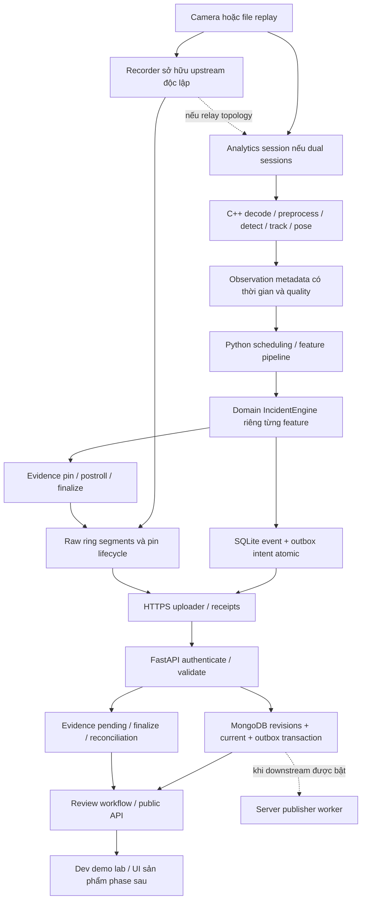

# Phân tích kiến trúc phục vụ triển khai

Ngày: 2026-10-11. Phạm vi: phân tích thiết kế trong repo và chuyển thành công việc có thể kiểm chứng. Đây không phải audit runtime hoặc kết quả benchmark.

Nguồn chuẩn: [CONTEXT](../../CONTEXT.md), [kiến trúc](../architecture/system-architecture.md), [plan](../architecture/implementation-plan.md), [readiness](../architecture/deployment-readiness.md), [ADR-0001](../adr/0001-feature-pipeline-boundaries.md), [ADR-0002](../adr/0002-server-downstream-event-publishing.md), [ADR-0003](../adr/0003-fastapi-mongodb-backend.md). [Mục lục checklist](README.md).

## 1. Hiện trạng có thể kết luận

- Kiến trúc, glossary, ba ADR accepted, roadmap P0–P5 và backlog M00–M17/89 task đã tồn tại. Q1–Q19 được ghi đã làm rõ trong plan; bản plan vẫn ghi chờ xác nhận tổng hợp trước triển khai runtime.
- CodeGraph đúng project trả 0 indexed files/nodes/edges. Không có source runtime trong danh sách file được Git theo dõi tại thời điểm khảo sát. Hai điều này giới hạn khả năng phân tích code; index trống tự nó không chứng minh mọi file trong workspace đều không có code.
- Chưa có bằng chứng trong bộ hồ sơ hiện hành cho hardware capacity, quality field, fault/soak hoặc production readiness. Không đánh dấu module complete từ việc đã có thiết kế.
- Local routing toggle không bật khi khảo sát. Phân tích trực tiếp bằng CodeGraph và đọc Markdown; không chạy local worker hoặc subagent, không reindex.

## 2. Luồng triển khai và ownership

Hai nhánh CAM→REC và CAM→ANA chỉ đồng thời mở trực tiếp khi chọn dual sessions. Nếu chọn relay, analytics subscribe recorder/stream-owner, không mở thêm session tương đương. Recorder phải tiếp tục khi analytics bị kill/hang trong failure boundary đã kiểm. Host, disk, nguồn điện và stream-owner vẫn có thể là lỗi chung.

## 3. Các ranh giới nên giữ

| Ranh giới | Trách nhiệm | Điều phải ngăn khi implement | Bằng chứng |
|---|---|---|---|
| Domain | Taxonomy, uncertainty, temporal FSM, pure policies | Vendor imports, tensors, DB/network/file I/O | Unit tests chạy không board/network, import boundary check |
| Application | Orchestration, budgets, use cases evidence/delivery/control | Accident rules nhét trong scheduler; generic event bus che control flow | Fake ports + integration traces |
| Ports/contracts | Semantic input/output/error/lifecycle | Một interface lớn ép mọi consumer nhận pixels hoặc SDK | Contract tests và producer/consumer review |
| Adapters | Source/runtime/model/storage/network/platform | `if board` trong domain, fallback im lặng | Conformance + typed failure tests |
| Composition root | Factories, capabilities, immutable snapshot, lifecycle | Untrusted dynamic imports; enabled config sai vẫn start | Startup/activation negative tests |
| Native/Python | C++ pixels/hot path; Python metadata và policy | NumPy pixel round-trip per frame; stale pose/result | Buffer tests, profiling, metadata boundary fixtures |
| Recorder/analytics | Raw evidence và recording ownership riêng | Analytics socket/DB lock/backpressure chặn recorder | Kill/hang/OOM-boundary và pin/cleanup tests |
| Edge/server | Offline detection, durable delivery và receipts | Gửi trước persist; receipt metadata coi như clip đã lưu | Crash/retry/duplicate/reorder tests |
| Backend/UI | Backend sở hữu review transitions; UI gọi public API | UI ghi DB, sửa AI confidence hoặc bypass raw access | API/browser authorization + conflict tests |

## 4. SOLID áp dụng tại các seam thực

| Nguyên tắc | Quy tắc triển khai | Cách review có thể kiểm |
|---|---|---|
| S — Single responsibility | Tách inference, temporal evaluation, evidence lifecycle, delivery và review; module không mặc định là service/process | Thay retry policy không sửa FSM; thay model không sửa server review; recorder lỗi không biến thành accident |
| O — Open/closed | Feature pipeline đăng ký bằng factory allowlist; chia sẻ perception tương thích; backend mới là adapter + manifest | Thêm feature chỉ thêm factory/config/fixtures, không sửa logic feature đã có; không tạo plugin system tổng quát |
| L — Liskov substitution | Adapter thay thế phải giữ clock/status/coordinate/reset/provenance semantics, không chỉ signature | Cùng C05 vectors và event regression cho oracle/native/RKNN; unsupported/failure không giả empty |
| I — Interface segregation | Tách metadata khỏi buffer; detector/pose/tracker khỏi tensor engine; delivery receipts metadata/clip riêng | Domain consumer không cần pixel/SDK; UI consumer không cần edge internals; interface tối thiểu cho use case |
| D — Dependency inversion | Domain không biết infrastructure; application phụ thuộc semantic ports; composition root inject concrete adapters | Review import/dependency direction và test qua fake nhỏ; không service locator, không abstract base class cho mọi helper |

Không dùng số lượng class/interface làm tiêu chí SOLID. Protocol/struct/function trực tiếp là đủ nếu biểu đạt contract và giữ đúng dependency direction.

## 5. Khoảng trống cần đóng bằng checklist

| Khoảng trống / điểm dễ hiểu sai | Hệ quả nếu bỏ qua | Công việc / gate |
|---|---|---|
| Chưa có exact camera/firmware/session tests | Dual sessions hoặc relay được chọn theo giả định, evidence sai thời gian | F01/F04/V04/R06, G1 live branch |
| Evidence targets chưa có sizing | Ring 10 phút/unACK 24h bị hiểu là bảo đảm dù quota không đủ | F03/R04/J05; không xóa pinned/unACK chỉ vì quá 24h |
| State/file transaction không atomic | DB báo complete nhưng clip thiếu hoặc hỏng sau crash | R03/J04/E01/E02, injection từng boundary |
| Perception parity chưa có fixtures/tolerance | Đổi SDK/backend giữ signature nhưng đổi event semantics | C05/N03/K02/P03/A03/I05 |
| Missing/gap chưa có expected outcomes | Mất pose/track bị xem là người bình thường | C02/K03/QL02/P04/I02, G2 |
| Review và AI revision cùng cập nhật | Revision cũ làm lùi current view hoặc reset review | S01/S02/W01, concurrency + out-of-order tests |
| Chưa có clock correlation xuyên máy | Báo đạt latency 5 giây từ phép trừ clock không hợp lệ | C01/UI01 và G1 report sai số đồng hồ |
| Negative audit chưa có cách giữ no-event clips | Ring đã xóa trước khi reviewer lấy mẫu, metric recall bị bias | D03 phối hợp R04/R05, sampling theo privacy/storage budget |
| Notification worker và intent bị gộp | Lab vô tình phát thông báo hoặc chờ broker mới nhận event | S01 persist intent; W02 disabled explicit ở lab; worker thực chỉ khi được bật |
| Demo UI dễ bị coi là UI vận hành | Chạy lab được nhưng pilot thiếu queue/fleet/accessibility phù hợp | UI01/UI02 cho G1; UI03/UI04 và đội UI cho pilot |
| Metrics/lệnh signed rollout chỉ mới là design | Native deadlock không báo fault, rollback mở trust bypass | H01/H02/T01–T06 và G4a |
| Gate đang dựa vào target thiếu owner | Unit pass bị xem là capacity/quality production đã đạt | Evidence record + sign-off G0–G5, không dùng TBD làm pass |

## 6. Làm rõ dependency để triển khai được

Những mục dưới là cách tách đầu ra của task, không đổi quyết định accepted hoặc bỏ gate:

1. **C01–C03 → C04–C05:** khóa semantic/schema trước generation; generator nhỏ nhất, không chờ chọn board. Conformance tolerance chưa chốt thì chưa chạy parity acceptance.
2. **F04/C03 → R01 → V04:** khóa ownership/pin/time contract trước recorder implementation; V04 tích hợp correlation sau recorder. Không đợi V04 hoàn chỉnh mới viết R01.
3. **I01 và N02/K01 → O01:** baseline event fixture pure-domain gắn synthetic/replay mở vertical slice; I02/I03 quality person-down nằm P2. G1 không tuyên bố nhận diện thực đạt G2.
4. **H01 baseline ở P1 → O03 P2 → O04/A05 P3:** health/queue visibility không đợi full fleet/control. O04+A05 là cùng integration run sau A03, không là hai vòng chờ nhau.
5. **B04 local activation → T02 trust → T04 signed integration:** dependency T02 trên hàng B04 áp dụng remote signed activation; local snapshot/LKG boundary có thể implement trước. Remote activation không được bật trước T02. Ghi rõ phần này khi mở issue B04.
6. **QL03 P2 camera-moved; G01/QL03 invalidation contract P4 → G02:** P2 chưa có geometry vẫn báo degraded ODD. P4 khóa validity interface trước projection implementation, không cần calibrated speed để làm person-down.
7. **S01 transaction/outbox intent P1; W02 side effects P4:** downstream intent durable theo ADR-0002 ngay khi ingest; worker/provider và assignment/escalation chỉ triển khai khi protocol cho phép. Disabled/pending không phải delivered; synthetic/replay không được vào notification outbox.
8. **UI01 mock theo C03 được làm sớm; UI01/UI02 nghiệm thu bằng API thật:** không chờ pipeline ML hoàn thiện để viết giao diện demo, cũng không coi mock flow là G1 đã đạt.
9. **D01 samples P0; D02–D05 evaluation P2:** dataset nhỏ được cleared mở oracle/conformance; field report và negative audit cần workload/rights/sample thực.
10. **G2 → vehicle research/calibration; G4b riêng:** person-down pilot không đợi vehicle nếu nhánh vehicle disabled. Khi bật vehicle phải đạt G4b và ghi scope riêng.

## 7. Thứ tự triển khai và điểm bàn giao

| Batch | Đội / phần việc có thể tiến hành | Contract/bằng chứng mở batch tiếp |
|---|---|---|
| 0 | Product/Edge/ML làm F01–F06, C01–C03, D01 samples | G0 phạm vi lab, facts/targets, fixtures cleared và ownership |
| 1 | Contracts C04/C05; bootstrap B01/B02; replay V01, oracle N02/K01; native N01 | Semantic kit; local startup/typed failure; deterministic replay |
| 2 | Backend S01/S02/E01/W01 + demo mock; recorder R01/R02 + journal J01; baseline I01 | Auth/schema/revision/pin contracts và transaction tests |
| 3 | Edge V02/V03/N03/N04/K02/N05; recorder R03/R04; delivery J02/J03; O01/O02/B03/H01; E02/UI01/UI02 | File/live vertical slice, API browser flow và crash/retry evidence G1 |
| 4 | Person-down QL01/QL02/K03/P01–P04/I02–I05/D02–D05/O03 | G2 quality/coverage và unknown semantics |
| 5 | Sau target selection: A01–A04 rồi O04/A05; native decode target nếu phù hợp | G3 parity + signed lab capacity envelope |
| 6 | R05/J04/J05/E03/H02/T01–T06; UI sản phẩm; I04/W02 nếu bật | G4a reliability/security/operations; G4b riêng nếu vehicle |
| 7 | Site field pilot, final quality/SLO, restore/revoke/rollout drills | G5 field acceptance + quyết định scale |

Trong batch, task vẫn phải đáp ứng prerequisites riêng; bảng không yêu cầu mọi task trong một batch phải xong trước task độc lập ở batch sau. Baseline J04 recovery và R06 process-crash được kéo vào G1; J05 power-cut/storage hardening đầy đủ ở G4a. Security/auth/quota/durable ACK bắt đầu P1.

Không gán ngày hoàn thành hoặc person-week khi chưa có người/thiết bị/workload. Estimate sau G0 và cập nhật bằng cycle time G1; checklist không tự cấp quyền triển khai production, gửi notification hoặc thay đổi thiết bị thật.
