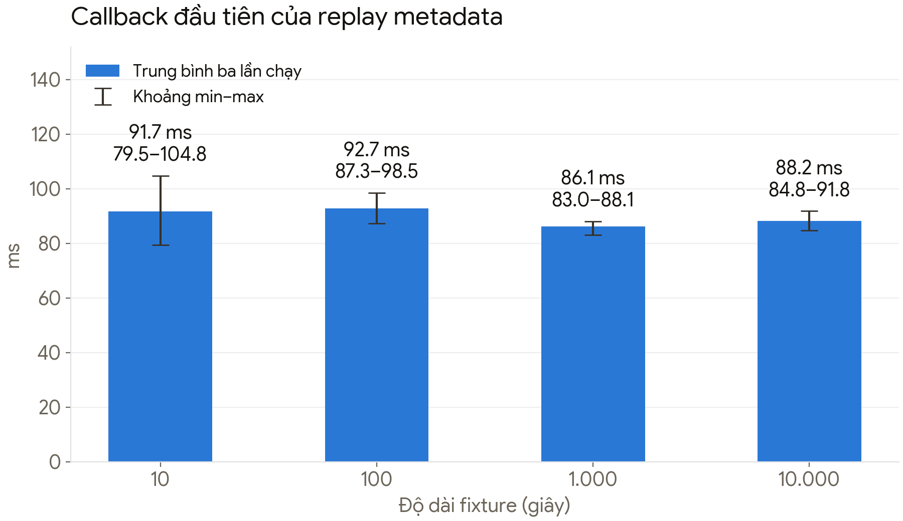
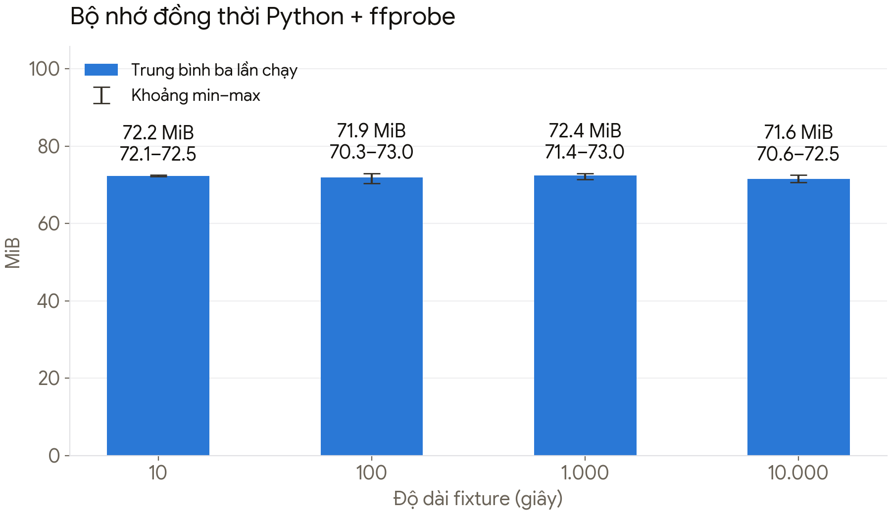

# Tóm tắt điều hành

## Mục đích và phạm vi

Báo cáo tổng hợp đầy đủ nghiên cứu AI Camera giao thông xử lý tại edge: camera và quang học, thuật toán nhận diện, runtime, kiến trúc lưu bằng chứng, dữ liệu, đánh giá, phần cứng, giá/BOM/TCO, bảo mật, vận hành, kết quả triển khai và quyết định tiếp theo. Người đọc không cần mở tài liệu nội bộ khác để hiểu các phân tích, số liệu, giới hạn hoặc khuyến nghị.

Nghiên cứu nền được thực hiện ngày 09–10/10/2026, thiết kế được đồng bộ ngày 11/10, code triển khai được đọc lại ngày 16/10/2026; số đo thử nghiệm giữ mốc lịch sử đến 15/10/2026. Mốc ngày theo môi trường ghi nhận. Giá giữ nguyên ngày quan sát, không phải quote hoặc tồn kho hiện tại. Nguồn công khai được lưu để truy xuất xuất xứ; không thay cho quyền thương mại, nghiệm thu phần cứng hoặc xác minh pháp lý theo site.

Baseline triển khai ban đầu là một camera cố định theo dõi person-down trong ROI lòng đường. Phạm vi 1–4 camera 1080p, 10–15 FPS phân tích/camera trong nghiên cứu chỉ là workload để thử, chưa phải capacity đã đạt. Vehicle, ANPR, helmet, đo tốc độ và vi phạm đèn đỏ là các nhánh mở rộng có điều kiện.

## Kết luận chính

1. **Tách PoC chức năng khỏi benchmark/production.** Có thể bắt đầu bằng máy sẵn có hoặc RPi5/ONNX Runtime và camera RTSP giá rẻ; chuyển Orange Pi5/RKNN bằng adapters/artifacts sau regression. Đây là lựa chọn triển khai, chưa chốt board hoặc cam kết FPS. Jetson/x86 vẫn là phương án benchmark nhiều camera; không đưa devkit trần ra cột đường cho production. Phần cứng cuối được quyết định bằng workload thực và điều kiện hiện trường.
2. **YOLOX + ByteTrack là baseline hợp lý**, nhưng detector và tracker không tự nhận diện tai nạn. Chỉ mở đối chứng RTMDet-tiny/small khi lỗi chất lượng hoặc benchmark cho thấy cần; bổ sung RTMPose theo track và logic chuỗi thời gian. Không triển khai nhiều framework cùng lúc nếu không tạo lợi ích đo được.
3. **Tốc độ/gia tốc và thay đổi tọa độ y là tín hiệu kích hoạt, không phải bằng chứng quyết định.** Cần hình học mặt đường, timestamps, độ tin cậy tracking và xác nhận diễn biến trước/sau. Bổ sung nhánh phát hiện ngã chậm và người nằm bất động.
4. **Không chẩn đoán đột quỵ từ camera.** Đầu ra phù hợp: nghi ngã/quỵ xuống, người nằm bất động hoặc người ở vị trí nguy hiểm; người trực xác minh và kích hoạt quy trình hỗ trợ.
5. **Đầu vào tốt nhất đến từ quang học/lắp đặt/exposure**, không phải chạy chuỗi deblur/deglare nặng trên mọi khung hình. Ảnh phục hồi có thể tạo giả ảnh và làm giảm độ tin cậy chứng cứ.
6. **Chỉ gửi sự kiện lên server là khả thi**, nhưng phải lưu clip nén trước/sau tại edge; server nhận metadata trước, ảnh/clip theo chính sách hoặc yêu cầu. Nếu không lưu video liên tục ở đâu, không thể truy hồi đoạn chưa được giữ lại.
7. **Quan sát giá ngày09-10-2026 khác MSRP tham chiếu.** Ví dụ Nano Super ở Hshop hiển thị 15.228.000 VND, Waveshare $634,99; không dùng mốc $249 làm ngân sách mua mà chưa có quote mới. Giá và điều kiện mua được trình bày đầy đủ ở phần chi phí và phụ lục giá của báo cáo.

## Hiện trạng và ưu tiên

Runtime được đối chiếu là Python cùng ONNX Runtime và FFmpeg. Detector YOLOX-Tiny, tracker hai giai đoạn và rule bbox/chuyển động/thời gian đã có; pose estimator/scheduler là khả năng tùy chọn, nhưng keypoints chưa quyết định sự kiện. Native C++ vẫn là hướng thiết kế đã duyệt; đề xuất xem lại thứ tự đầu tư sau profiling chưa thay quyết định đó.

Replay synthetic có 12/12 run callback đầu trước ffprobe EOF. Các kết quả này hỗ trợ regression phần mềm và xử lý metadata incremental, chưa chứng minh chất lượng person-down, capacity thiết bị đích, WAN24h, mất điện an toàn hoặc field readiness.

Ưu tiên tiếp theo: đóng snapshot và evidence; kiểm chứng camera/PTS/frame age; A/B rule–pose và FPS; kiểm tra upload, quota, SQLite và recovery; sau đó mới chọn hotspot native, accelerator và board dựa trên đo đạc cùng TCO.

# Phát hiện chính

## Camera, quang học và miền hoạt động

### Phải xác định trước khi mua

- Đường/giao lộ/vỉa hè nào, tốc độ và mật độ xe máy, vùng quan sát và thời tiết.
- Góc lắp, chiều cao, tiêu cự, người ở xa còn bao nhiêu pixel; người bị xe che và ngã ra ngoài khung có được xem là ngoài miền hỗ trợ không.
- Phân biệt camera toàn cảnh phục vụ sự kiện với camera chuyên biển số. Một camera góc rộng thường không đồng thời đáp ứng pose người xa và biển số xe nhanh ban đêm.
- Khuyến nghị camera cố định. PTZ làm thay đổi ROI/homography; phải biết preset và calibration tương ứng, hoặc dừng kết luận tốc độ/vi phạm trong lúc quay.

### Thông số mua và nghiệm thu

Camera IP PoE, RTSP, ONVIF Profile T; 1080p hoặc 4MP tùy pixel-on-target; 25–30 FPS nguồn; chỉnh được shutter/gain/WDR; hoạt động đêm có chiếu sáng phù hợp; IP67 cho camera ngoài trời. Profile M hữu ích nếu tích hợp metadata AI vào VMS, không phải điều kiện để một camera thường cấp RTSP cho edge. Đối chiếu conformant product/firmware thực tế, không chỉ chữ “ONVIF” trên brochure.

Giữ main stream chất lượng đủ bằng chứng; chọn luồng phân tích/crop ROI theo nhu cầu. Resize toàn cảnh xuống 640×640 có thể làm người/biển số quá nhỏ; khi đó thay tiêu cự, thêm camera, crop hoặc input lớn hơn, thay vì chỉ mua GPU mạnh hơn. Crop/tile tăng số inference và cần chống trùng tracking.

Shutter tham khảo 1/250–1/1000 giây cho đối tượng nhanh chỉ là điểm bắt đầu thử nghiệm; ban đêm cần thêm ánh sáng, cân bằng gain/noise. Không bảo đảm mọi cảnh chạy được shutter nhanh. WDR đa exposure có thể gây artifact ở đối tượng chuyển động. Axis [1] nhấn mạnh exposure ngắn và chất lượng xử lý quan trọng hơn chỉ số dB đơn lẻ.

### Tiền xử lý có điều kiện

**Baseline lab:** software decode  >  sửa distortion nếu cần  >  crop/resize/letterbox  >  normalize theo đúng model. Khóa và version biến đổi tọa độ để tracking/calibration không bị lệch.

**Chỉ khi phát hiện vấn đề:** quality gate đo blur, vùng cháy sáng, thiếu sáng, freeze, che lens và rung. CLAHE/denoise nhẹ hoặc stabilization thử A/B theo đêm/mưa. Nếu stabilize, cập nhật phép ánh xạ về tọa độ gốc/mặt đường; rung lớn phải báo mất calibration.

**Không mặc định:** neural deblur, dehaze, super-resolution hay generative enhancement trên tất cả frame. Đánh giá bằng event recall/báo giả, không chỉ ảnh đẹp/PSNR. Giữ bản nén gốc làm bằng chứng; ảnh đã enhance phải có nhãn và không thay thế ảnh gốc. Vùng bão hòa trắng không thể phục hồi đáng tin chi tiết đã mất.

### Camera RTSP giá rẻ cho PoC

| Model | Giá đọc lại10-10-2026 | Vai trò và giới hạn |
|---|---:|---|
| Tapo C100 | 339.000 VND | 1080p Wi-Fi, trong nhà, test pipeline cơ bản |
| Tapo C110 | 389.000 VND | 3MP Wi-Fi, góc cố định; lựa chọn tiết kiệm khuyến nghị |
| Tapo C200 | 399.000 VND | 1080p quay/quét; giữ góc cố định khi test tracking/ROI |
| Tapo C310 | 649.000 VND | 3MP, Wi-Fi + Ethernet, IP66; không mặc định có PoE |
| EZVIZ H1c | Chưa kiểm tra giá | 1080p H.264; iSpyConnect liệt kê RTSP `/11` và `/channel1`, cần thử firmware cụ thể |

Giá Tapo từ trang bán, không phải xác nhận tồn kho/VAT/checkout. `tapo.com.vn` là nguồn retail, không tự coi website chính thức của hãng. Nguồn hãng về RTSP: Nguồn [2] . Cần tạo Camera Account riêng trong app; stream1/stream2, local LAN; không cần thẻ nhớ để ứng dụng edge nhận RTSP. Không áp dụng chung cho camera dùng pin. Báo cáo bao gồm toàn bộ 20 quan sát giá cùng điều kiện mua trong phụ lục.

H1c: Nguồn [3] liệt kê model cụ thể với RTSP, là bằng chứng compatibility bên thứ ba. Trang hãng Nguồn [4] công bố H.264, max1Mbps và FPS tự thích ứng, nhưng không ghi RTSP. **Không loại H1c chỉ vì trang hãng không ghi RTSP**; cũng không suy các dòng RTSP thành xác nhận ONVIF hoặc mọi firmware. Phải thử VLC, local operation khi WAN ngắt, reconnect và FPS/latency. Credential thiết bị phải xác minh, không giả định là mật khẩu cloud.

Camera A9 chưa xác minh local stream/SDK: không khuyến nghị mua để viết AI chỉ dựa tên1080p; yêu cầu demo VLC trước. Wi-Fi/Ethernet là transport mạng, không ranh giới nghiệp vụ khác nhau. Camera giá rẻ chỉ đánh giá integration, không chứng minh event accuracy ngoài đường. Thay camera phải cập nhật lens/ROI/calibration, ODD, decode và regression.

### Module IMX219 so với camera IP hoàn chỉnh

Waveshare IMX219-160 SKU16662: sensor1/4inch, ảnh tối đa8MP3280×2464, F2.35, FOV160° **đường chéo**, distortion hãng <14,3%, CSI-2, bản không IR. Nguồn: Nguồn [5] . Camera Hikvision DS-2CD2T43G2-4I có sensor1/3inch, F1.6, WDR120dB, IR-cut/IR và vỏIP67 theo trang hãng. Không so góc đường chéo với ngang; 8MP ảnh tĩnh không mặc nhiên8MP30FPS.

Đối tượng xa trong góc160° có ít pixel; resize/correction giảm chi tiết hiệu dụng. Camera IP phù hợp thường có lợi thế ngày/đêm/lắp ngoài trời; không khẳng định mọi camera IP tốt hơn mọi module. Module CSI có thể tránh video compression và hỗ trợ control sâu, nhưng phải làm ISP/driver/lens/IR/cooling/enclosure. Chọn module hẹp/sensor phù hợp nếu sản xuất camera all-in-one; IMX219-160 không phải baseline lý tưởng cho pose người xa/ANPR. Pixel-on-target và video chuyển động quan trọng hơn megapixel.

### Tận dụng AI native của camera

DS-2CD2T43G2-4I: hãng công bố motion human/vehicle classification, line crossing, intrusion, face detection; API ISAPI/SDK, ONVIF S/G. Nguồn: Nguồn [6] . Face detection không phải nhận dạng danh tính; không xác minh ANPR/fall/crash từ lời quảng cáo nhà bán.

Ba mức tích hợp:
1. Event-only: nhận alarm vùng/vạch, lấy clip và gửi server; có thể thay AI cho đúng sự kiện đã kiểm chứng.
2. Hybrid trigger: native event kích hoạt verifier, nhưng giữ phân tích nền để không bỏ ngã chậm/người đã nằm.
3. Dense metadata: chỉ thay detector/tracker nếu camera xuất bbox/class/timestamp/coverage liên tục và track ID đủ tốt. **Chưa xác minh mức3 cho model này.**

ISAPI/SDK hoặc ONVIF label không đảm bảo mọi metadata capability. RFQ/demo cần payload mẫu, rate, IDs, coordinate system, firmware, local auth và no-cloud operation. Không OCR bbox overlay hoặc screen-capture app làm pipeline production.

## Model, thuật toán và giấy phép

| Thành phần | Vai trò | Giấy phép mã nguồn đã kiểm tra | Đề xuất |
|---|---|---|---|
| YOLOX nano/tiny/small | Person/vehicle detector | Apache-2.0 | Baseline đầu tiên, fine-tune điều kiện Việt Nam |
| ByteTrack | Liên kết detection theo thời gian | MIT | Baseline tracker; đánh giá ID switch và xe máy đông |
| RTMDet trong MMDetection | Detector thay thế | Apache-2.0 | So sánh với YOLOX bằng cùng dữ liệu và cùng pipeline |
| RTMPose trong MMPose | Keypoint trên crop người | Apache-2.0 | Chạy chọn lọc và theo chuỗi, không kết luận từ một pose |
| MMAction2 | Huấn luyện/triển khai action classifier | Apache-2.0 | Chỉ thêm nếu temporal rule không đạt mục tiêu |
| PP-YOLOE/RT-DETR trong PaddleDetection hoặc RT-DETR official | Detector thay thế | Apache-2.0 | Tùy kinh nghiệm team; kiểm chứng export/precision |
| Supervision | Annotation/utility | MIT | Tùy chọn, không phải model tai nạn |
| Ultralytics | Detector/pose/tooling | AGPL-3.0 hoặc Enterprise | Không ưu tiên cho sản phẩm đóng nguồn nếu chưa giải quyết hợp đồng |

Nguồn gốc: YOLOX [7], ByteTrack [8], MMDetection [9], MMPose [10], PaddleDetection [11], Ultralytics [12].

**Quan trọng: bảng trên xác nhận code, không xác nhận mọi pretrained weight được phép thương mại.** Phải duyệt từng checkpoint: URL, hash, tag, model card, giấy phép weight, dữ liệu pretrain/train và dependency. RTMPose có nhiều checkpoint dùng mixed datasets; không gán cùng kết luận cho tất cả. Fine-tune không tự xóa hạn chế nguồn gốc. COCO annotation và ảnh Flickr nguồn không phải một giấy phép blanket duy nhất.

Apache/MIT cho phép sử dụng code thương mại với nghĩa vụ license/notice tương ứng; AGPL không cấm kiếm tiền, nhưng có nghĩa vụ copyleft/source tùy phân phối, sửa đổi và truy cập mạng. Với sản phẩm proprietary dùng Ultralytics, cần đánh giá pháp lý và Enterprise/OEM terms thay vì suy luận AGPL tự động được phép hay bị cấm. Không thấy mức phí Enterprise công khai đủ để lập dự toán.

**Stack thực tế tại 15-10:** YOLOX-Tiny ONNX  >  tracker Python hai giai đoạn  >  rule bbox/chuyển động/thời gian. RTMPose estimator/scheduler đã có implementation tùy chọn; pose outcomes chưa được IncidentEngine dùng để quyết định sự kiện. Temporal classifier tự huấn luyện chưa được xác nhận. RTMDet là đối chứng tùy kết quả, không bắt buộc PoC và không cài song song trong baseline. Detector COCO mặc định không có nhãn tai nạn, ngã, helmet hoặc biển số.

## Thiết kế nhận diện sự kiện

### Tracking và tốc độ

ByteTrack dùng cả detection độ tin cậy thấp để phục hồi track; vẫn có ID switch khi đông xe, che khuất và detector bỏ sót. Detection phải đủ tốt trước khi thêm ReID. Có thể so sánh tracker có camera-motion compensation/ReID nếu giảm lỗi thực sự; ReID gây thêm compute và nghĩa vụ dữ liệu.

Với camera cố định, chọn điểm gần tiếp xúc mặt đường, không dùng tâm bounding box như tọa độ vật lý. Hiệu chuẩn intrinsic/distortion và homography từ mốc tọa độ đo thực tế, biến điểm ảnh thành mét:

`v(t) ≈ [X(t) − X(t−dt)] / dt`, `a(t) ≈ [v(t) − v(t−dt)] / dt`.

Dùng timestamp thật, không giả định mọi frame đúng 1/30 giây. Lọc chuỗi vị trí bằng Kalman/robust regression và cửa sổ thời gian; loại outlier, che khuất, ID switch. Homography chỉ đúng gần mặt phẳng đường và điểm contact phù hợp; cầu dốc, nhiều mặt phẳng, bbox bottom không đúng contact và PTZ gây sai. Ước lượng sai số theo vùng camera; confidence thấp thì xuất unknown, không xuất km/h chính xác giả.

Gia tốc là đạo hàm tiếp theo nên rất nhạy với jitter. Không đặt một ngưỡng gia tốc pixel rồi gọi tai nạn. Tốc độ phục vụ cảnh báo kỹ thuật khác tốc độ đủ điều kiện làm bằng chứng; radar/thiết bị đo có hồ sơ phù hợp là lựa chọn nếu mục tiêu xử phạt.

### Tai nạn: nhiều tín hiệu + diễn biến hậu sự kiện

Một candidate score gồm: quỹ đạo tiếp cận/cắt nhau, khoảng cách footprint trên mặt đường, chuyển hướng/dừng đột ngột, xe có tư thế bất thường, người/vật xuất hiện trên đường, các đối tượng liên quan không phục hồi chuyển động. Bbox overlap không chứng minh chạm; TTC chỉ báo rủi ro với giả định chuyển động tương đối, không chứng minh collision.

State machine đề xuất:

`normal  >  candidate  >  verifying  >  suspected  >  closed`. Review server độc lập: unreviewed > confirmed/false_positive, confirmed > resolved; correction/reopen có audit và needs_re_review với audit và cờ cần review lại khi nội dung mới có ý nghĩa.

Duration xác minh là threshold theo ODD cần nghiệm thu; evidence lab giữ pre10/post20 tính theo anchor, tách khỏi verification window. Classifier chỉ thêm khi chất lượng đã đo yêu cầu; cảnh báo khẩn có thể gửi sớm rồi cập nhật confidence/clip, không đợi hết clip. Phân biệt hard negatives: phanh gấp, kẹt xe, chuyển làn, đỗ xe, người băng qua, xe đi qua nhau khác chiều sâu, track mất rồi xuất hiện lại. Cooldown và dedup theo camera/thời gian/vùng/track graph, không suppress một tai nạn mới chỉ vì gần sự kiện cũ.

Nếu rule không đủ chất lượng, dùng temporal classifier nhẹ trên trajectory + pose + crop sequence; đầu tiên thử feature classifier/TCN, sau đó mới xét video network nặng. Đây là hướng thiết kế, không phải model tai nạn đã đạt accuracy xác nhận.

### Té ngã/quỵ xuống và người bất động

Trigger y bất thường chỉ là một nhánh. Bổ sung thay đổi tỷ lệ bbox, độ cao đầu/hông chuẩn hóa theo kích thước người, góc thân, chuyển động xuống mặt đường, mất chuyển động và tư thế nằm duy trì. Bộ trigger cần ưu tiên recall; giảm báo giả ở bước temporal verification.

- **Ngã nhanh:** trigger mở ROI pose và chuỗi khung gần sự kiện; không chỉ pose một ảnh.
- **Ngã chậm:** low-rate pose sampling trên track người đủ lớn hoặc nhánh theo dõi thay đổi tư thế chậm. Tần suất 1–3 FPS/track là điểm bắt đầu PoC, không cam kết đủ cho mọi chuyển động.
- **Người đã nằm khi vào khung/camera restart:** persistent lying/abnormal posture detector; không bắt buộc thấy chuyển tiếp đứng > ngã.
- **Pose đang nghi vấn:** tăng tần suất ví dụ 8–15 FPS trên ROI có confidence; giới hạn tổng ROI và báo trạng thái giảm năng lực khi quá tải.
- **Keypoint thiếu/che khuất:** unknown; không diễn giải thành người an toàn hoặc bất động.

Phân biệt đứng > ngồi, ngồi xổm, cúi buộc giày, nhặt đồ, nằm nghỉ, người bị xe che, người xuống xe máy. Dùng chuỗi tư thế, gần mặt đất, thời gian duy trì và hồi phục. Ngưỡng duration cần cân bằng cảnh báo sớm và báo giả; nằm trên làn xe có thể ưu tiên cảnh báo ngay bất kể nguyên nhân.

**Không gán nhãn đột quỵ/ngất/mất ý thức.** Camera không có thông tin lâm sàng đủ; cảnh báo cần người xác minh và quy trình liên hệ cứu hộ/cấp cứu phù hợp. Không tự động gọi cấp cứu hàng loạt từ một confidence threshold chưa được nghiệm thu.

### Phạm vi ngoài baseline

ANPR/helmet/vi phạm đèn đỏ, radar, ReID và nhận dạng danh tính không nằm trong backlog hiện hành. Chỉ mở nghiên cứu riêng khi có use case/ODD/rights được xác nhận. Vehicle suspected incident sau person-down có gate G4b, không tự mở toàn bộ các tính năng camera giao thông.

## Video pipeline, runtime và edge–server

Thiết kế đích gồm hai nhánh độc lập từ camera RTSP đã nén:

- Nhánh bằng chứng: compressed segments  >  raw ring  >  pin clip trước/sau anchor  >  upload và truy hồi.
- Nhánh phân tích: software decode (hardware khi đã chọn và đo)  >  quality metrics  >  crop/resize  >  detector  >  tracker  >  trajectory/hình học và pose chọn lọc  >  temporal verifier  >  event state machine.
- Liên kết bền vững: event/outbox/pin intent được lưu nguyên tử trong journal; receipt và reconcile xử lý các crash window của filesystem và mạng.
- Central server: HTTPS  >  FastAPI  >  MongoDB transaction/receipt  >  review và evidence filesystem  >  giao diện demo. Native decode/temporal pose verifier là thiết kế đích, chưa được xem là implementation hoàn thành.

### Lựa chọn phần mềm

- NVIDIA: JetPack/CUDA/TensorRT, GStreamer hoặc DeepStream nếu đa luồng và zero-copy mang lại lợi ích. Phải dùng ma trận version tương thích device/JetPack/CUDA/TensorRT/DeepStream; không mặc định tài liệu DeepStream mới nhất chạy được trên mọi Orin.
- Intel: OpenVINO + decode phù hợp iGPU; kiểm tra codec profile/driver và tác động CPU khi fallback.
- Portable: ONNX Runtime; thực nghiệm TensorRT/OpenVINO execution providers tùy thiết bị.
- Hailo/RK: compiler/runtime riêng; kiểm tra operator, NMS, pose decode, INT8 calibration, dynamic shapes, toolchain host, RAM và fallback CPU. TOPS cao không bảo đảm deploy được model mong muốn.
- MediaMTX có thể proxy/record/playback RTSP; không transcode video chỉ vì chuyển protocol. Không bắt buộc dùng nếu GStreamer segmentation đã đủ.
- Backend lab đã chốt: HTTPS event ingress, FastAPI/Python + MongoDB replica set một member/persistent volume; transaction readiness/retry phải chạy trên exact version. Evidence filesystem qua adapter, dev demo HTML/JS do FastAPI phục vụ. Server giữ downstream intent; chưa bật broker/notification. Production storage/HA là gate riêng, không coi lab là HA.

ORT MIT, OpenVINO Apache; GStreamer core LGPL, FFmpeg phụ thuộc cấu hình build; TensorRT/DeepStream full SDK chịu điều khoản NVIDIA. Giấy phép của runtime, codec và bản build phải được duyệt riêng. Audit `ffmpeg -buildconf`, `ffmpeg -L`, plugin và codec; `--enable-gpl` thay nghĩa vụ, `--enable-nonfree` có thể làm binary không được phân phối. Không gọi toàn bộ pipeline là open source miễn ràng buộc chỉ vì code ứng dụng MIT.

### Clip và truy hồi

**Orin Nano không có NVENC**, theo NVIDIA [13]. RTSP camera đã H.264/H.265 có thể remux/lưu compressed packets không encode lại. Nếu ghi overlay hoặc privacy masking lên video ở edge, có thể cần decode + re-encode software, rất khác ngân sách compute. Giữ raw clip bảo vệ truy cập, gửi bản đã che theo yêu cầu; xác định rõ privacy masking ảnh hưởng quyền truy cập raw.

Lab dùng ring10 phút, pre10/post20 giây quanh onset hoặc first qualifying observation khi thiếu onset. Segment/GOP là thông số đo theo source, không thay requested interval. Event/outbox/evidence request cùng transaction; recorder persist pin receipt trước ACK, retry/query theo request ID. Ring budget phải tính verification/handoff/recovery; không đủ thì partial/missing. Clip keyframe-aligned có thể dài hơn cửa sổ yêu cầu; ghi timestamp chính xác và không cắt bừa giữa GOP. Nếu muốn truy hồi lịch sử bất kỳ, phải lưu liên tục nhiều giờ/ngày tại edge/NVR; ring buffer vài phút không đủ.

Metadata AI là full snapshot theo revision, identity/origin bất biến; clocks có domain/uncertainty. Review giữ viewed event/evidence versions và audit riêng. Evidence có build/completeness/transfer/availability/integrity riêng: clip partial vẫn được upload/ACK. Track ID không phải danh tính. Mỗi bản sửa sự kiện phải giữ đủ identity, origin, phiên bản model/config/calibration, nội dung quan sát và các yêu cầu evidence; các trạng thái evidence không được gộp thành một cờ thành công.

Store-and-forward: durable outbox, HTTPS retry theo device/event/revision và canonical content hash; ACK metadata và clip riêng. Outage24h là sizing budget, không tự xóa pinned/unACK khi hết 24h. Server clip retention7 ngày; edge release sau clip receipt và policy, metadata ACK không đủ. Khi protected data đầy quota, giữ dữ liệu đã bảo vệ, event mới evidence partial/failed và báo degraded. Báo lỗi hết bộ nhớ, không xóa bằng chứng im lặng. Clip có checksum/hash hỗ trợ integrity nhưng một hash đơn lẻ không chứng minh toàn bộ chuỗi chứng cứ chưa bị sửa.

### Tính lưu trữ và băng thông

Ví dụ **4 camera × 4 Mbps**: 16 Mbps local video, không cần gửi WAN liên tục. Lưu liên tục: `4 Mbps × 86400 / 8 ≈ 43,2 GB/camera/ngày`, tổng **172,8 GB/ngày**, khoảng **1,21 TB/7 ngày**, chưa filesystem/bitrate overhead. SSD 1TB với 20% dung lượng dự phòng còn khoảng **4,6 ngày** theo giả định này, chưa OS/clip pinned. TB thập phân; không đồng nhất TiB.

Clip 30 giây ở 4 Mbps ≈ **15 MB/camera**. 100 clip/ngày từ một camera ≈ 1,5 GB; tổng 100 sự kiện/ngày từ cả fleet khác với mỗi camera 100. Thumbnail/metadata làm tăng thêm. Tính theo VBR thực tế và event burst; giảm băng thông không đồng nghĩa không còn dữ liệu cá nhân. Chọn SSD theo endurance/TBW, write workload, nhiệt độ và power-loss protection khi cần, không chỉ dung lượng/giá consumer NVMe.

## Dữ liệu và phương pháp đánh giá

| Nguồn | Giá trị | Hạn chế/quyền |
|---|---|---|
| DoTA | Annotation anomaly thời gian/không gian | Dashcam khác camera cố định; MIT repo cho software không clear video |
| DAD | Accident anticipation | Dashcam; chưa xác minh commercial grant |
| TAD/TADBench | Tai nạn camera giám sát/highway | Gần bài toán hơn; quyền thương mại chưa xác minh |
| UR Fall | Ngã + hoạt động thường ngày | Tác giả nêu rõ **CC BY-NC-SA 4.0**, cần xin quyền thương mại |
| UP-Fall/Le2i | Ngã diễn xuất/multimodal | Khác miền ngoài đường; commercial license chưa xác minh |
| OmniFall | Taxonomy falling/fallen, đa miền | Kiểm tra từng nguồn video/subset; license bài báo không clear dataset |

UR Fall [14] không dùng thương mại mặc nhiên. “Public download”, citation hay mirror gắn MIT không thay giấy phép của tác giả/video. Với nguồn unknown: chỉ dùng trong phạm vi được cho phép sau khi duyệt, không đưa vào training sản phẩm rồi giải quyết sau.

Thu dữ liệu địa phương có hợp đồng quyền sử dụng/training và quy trình riêng tư: ngày/đêm/mưa, góc camera, xe máy, người lớn/trẻ nhỏ, che khuất, người xa; hard negatives phanh/đỗ/ngồi/cúi/nằm nghỉ. Không diễn xuất ngã/tai nạn nguy hiểm ngoài đường; mô phỏng có kiểm soát/đóng đường có phép, dùng diễn viên và phương án an toàn; synthetic hỗ trợ chứ không thay validation thực.

Split theo site/camera/ngày/person/video, không chia frame liền nhau vào train/test. Tập real-world riêng; annotation event onset/end, visible/unknown, severity, liên quan tracks, reviewer agreement. Hiếm tai nạn thật làm số liệu dễ quá tự tin; ghi số sự kiện, tổng camera-hours, confidence intervals. Không lấy mAP detector hay accuracy frame làm độ chính xác tai nạn.

**Acceptance hiện hành:** lab một camera; P95 durable edge commit > dashboard ≤5 giây trên LAN, clock correlation/số mẫu rõ. Không bao gồm temporal verification hoặc post-roll/upload. Pre10/post20 phải đủ requested range khi nguồn có dữ liệu; missing/gap báo partial. Đây là target chưa nghiệm thu.

Recall, false alerts/camera-day, analysis FPS, pose burst, RPO/RTO và operator capacity phải thành preliminary targets có owner với owner được gán và tiêu chí chấp nhận rõ ràng, sau đó ký từ số đo. Không giữ các ngưỡng nghiên cứu cũ 90%/1 báo giả/ngày/2 giây như requirements mặc định. Semantic replay dùng fixed inputs và virtual clock; realtime stress đo drop/coverage riêng. G3 target soak24–72h gồm recording/upload; field pilot cần đủ sample/event/camera-days, không cam kết hoàn tất theo số tuần cố định.

Đánh giá recall gồm negative audit phân tầng lấy clip trước ring expiry, inclusion probability/trọng số, missing coverage, matching windows và uncertainty; không suy recall từ alerts-only hoặc cộng raw sample counts giữa strata khác tỷ lệ.

Nếu không có báo giả trong T camera-ngày, upper bound Poisson một phía 95% xấp xỉ 3/T, chỉ là ước tính với giả định độc lập/rate ổn định. Ví dụ 0 trên 30 camera-ngày vẫn chỉ hỗ trợ upper bound khoảng 0,1/ngày, không chứng minh zero error. Mưa/đêm tương quan đòi hỏi đánh giá phân tầng.

## Phần cứng và hiệu năng kỳ vọng

**Các mức dưới đây là phạm vi ưu tiên thử nghiệm, không benchmark bảo đảm.** Workload: 1080p 25–30 FPS nguồn, detector 640 hoặc tương đương 10–15 FPS/camera, tracking, pose chọn lọc, raw compressed recording, không neural deblur/video overlay liên tục. Người quá nhỏ cần input/crop tăng tải.

| Nền tảng | Mục tiêu bắt đầu thử | Ưu/nhược chính |
|---|---|---|
| Intel N150, 16GB | 1 camera; mở rộng 2 sau đo | Giá/điện tốt, OpenVINO; chưa mặc định đủ 15 FPS + pose nhiều người |
| Jetson Orin Nano Super 8GB | 1–2 camera; thử 4 sau tối ưu | CUDA/TRT, decode; RAM chung CPU/GPU 8GB, không NVENC, devkit chỉ PoC |
| Orin NX16 edge computer | 2–4 camera; thử 4–8 workload nhẹ | RAM dư hơn, encode tùy cấu hình; phải audit SKU/carrier/tản nhiệt, không mặc định industrial temperature |
| x86 RTX5060 8GB + RAM32GB | 4 camera; thử 8 sau benchmark | Dễ phát triển/nâng cấp, NVDEC/NVENC; VRAM8GB có giới hạn batch/multi-model, điện và bảo trì cao hơn |
| Pi5 + Hailo8L/8 | 1–2 detector stream làm thử | Accelerator tiết kiệm; pose/export/host decode/compiler là rủi ro tích hợp |
| RK3588(S) 8GB | 1–2 stream nhẹ làm thử | Giá thấp tiềm năng; 6TOPS marketing không chứng minh capacity, RKNN operator/INT8 cần test |

Không so INT8 sparse TOPS với FP16/FP4 TFLOPS hoặc dùng phép chia TOPS để ra số camera. FPS detector tổng không bao gồm mặc định pose, decode, tracking, recording, upload và nhiệt tủ kín. DeepStream benchmark [15] đo pipeline có cấu hình cụ thể, tắt rendering/OSD/tiler; không áp số trên thiết bị khác cho YOLOX của dự án.

Ước lượng tải: `detector_FPS_required = camera_count × analysis_FPS × crops_per_frame`. 4×15×1 =60 full-frame inference/s; tile 4 ROI tăng thành 240 nếu chạy cả 4 mỗi frame. Pose tải phụ thuộc số người được kích hoạt: 20 ROI×10FPS =200 crop inference/s trong burst. Ngân sách không chỉ detector. CPU NMS/pose decode/Python copies có thể là bottleneck trước GPU.

Khi benchmark: đo detector-only và end-to-end riêng, FP16 trước rồi INT8 với representative day/night calibration; so event quality sau quantization. Đo 1/2/4/8 RTSP stream, burst người, network loss; RAM/VRAM, CPU/GPU, nhiệt, disk I/O, frame drops và P95/P99. Dành headroom mục tiêu khoảng 25–30%, không dùng 100% GPU làm capacity nghiệm thu.

NVIDIA lifecycle [16] nêu devkit để phát triển/prototype, không production. Module Orin NX/Nano có thời hạn cung ứng công bố đến Jan2032; không đồng nghĩa bảo hành hệ thống đến thời điểm đó. Jetson Thor là phương án compute cao tham khảo, chưa có lợi ích/giá được chứng minh cho PoC này.

Camera AI all-in-one Viettel VCAM-YITS-01 [17] đáng mời demo/RFQ: Qualcomm edge, ANPR/vehicle/violation và tích hợp radar; chưa có xác nhận công khai về fall/accident, khả năng nạp model riêng hay giá. So total integration cost, không chỉ giá box; không suy capture rõ 250km/h là chứng nhận đo tốc độ.

## Giá lịch sử, BOM và tổng chi phí

### Giá quan sát ngày09–10-10-2026

Giá ở đây là số đã hiển thị trên trang/HTML/schema tại ngày quan sát, **không phải MSRP hoặc giá của bài review cũ**. Tồn kho/schema có thể sai; cần báo giá có hiệu lực, checkout, VAT, ship, SKU và bảo hành trước khi đặt. Không có quy đổi USD/CZK sang VND như tỷ giá live.

| SKU/nhà bán | Giá hiển thị | Điều kiện/mức xác minh |
|---|---:|---|
| Orin Nano Super 8GB Hshop | **15.228.000 VND** | HTML visible price và JSON price trùng; trang BH1 năm, kèm PSU; VAT/stock checkout chưa xác nhận |
| Orin Nano Super Waveshare | **$634,99** | Trang bán/raw/schema, InStock; chưa ship/thuế nhập khẩu |
| Orin NX16 reComputer J4012 Seeed | **$1.749** | Trang bán hiển thị in stock; exact bundle/accessories cần RFQ |
| GMKtec G3 Plus N150 16GB/1TB | **11.060.000 VND** | Biến thể có hàng được kiểm tra; không lấy barebones rẻ hết hàng làm giá bộ hoàn chỉnh |
| INNO3D RTX5060 Twin X2 8GB An Phát | **9.399.000 VND** | Có VAT; stock “Liên hệ”; **chỉ bán cùng build PC**, không giá mua GPU rời độc lập |
| Colorful RTX5060 Battle AX DUO Phong Vũ | **13.990.000 VND** | Đọc trực tiếp trang; stock/VAT/checkout chưa xác nhận |
| SSD Kingston NV3 1TB MemoryZone | **3.790.000 VND** | HTML giá sale + schema; schema InStock; giá gạch 4.190.000 không dùng làm giá hiện tại |
| Hikvision DS-2CD2T43G2-4I camera4MP | **5.210.000 VND** | Trang camerahikvision.vn ghi còn hàng; VAT chưa xác nhận; mô tả có mâu thuẫn IR30/80m, đối chiếu datasheet hãng |
| AI HAT+ 13TOPS PiVietnam | **2.400.000 VND** | Chưa VAT, BH6 tháng; không gồm Pi5/nguồn/SSD; 26TOPS không cùng giá mặc định |
| Hailo8 M.2 Waveshare | **$179,99** | Schema InStock; host/carrier/ship/thuế không gồm |
| Orange Pi5 RK3588S8GB Techfun | **3.746 CZK** | Visible price; hết hàng; schema3808 khác, không dùng schema để thay giá visible |

Bổ sung lựa chọn giá thấp hơn đã đọc: Hikvision DS-2CD1043G2-LIU [18] **1.263.000 VND**, stock metadata; trang hãng [19] đã xác nhận WDR120dB, PoEmax6,5W và ProfileT; **4MP chỉ20FPS, 1080p25FPS ở50Hz**, nên không gán30FPS cho mọiSKU. Không coi chỉ sốWDR là chất lượng ban đêm tương đương camera cao cấp hoặc đủANPR; kiểm tra lens/firmware đúng đơn hàng. UPS APC BX650LI-MS [20] **998.000 VND chưa VAT**, 650VA/325W; runtime phải đo theo tải, không mặc định phù hợp x86 GPU. TP-Link TL-SG1005P-PD [21] **790.000 VND** là switch nhận nguồn PoE upstream, **không** thay switch AC trực tiếp nếu thiếu injector. Palit Pandora Nano Super8GB [22] **20.900.000 VND**, schema stock và VAT excluded; vỏ máy không mặc nhiên đạt chuẩn ngoài trời. SKU Seeed J4012 trong bảng là **reComputer Industrial J4012**, trang quảng cáo100TOPS; không tự gán157TOPS Super nếu chưa xác minh firmware/carrier/thermal.

Không cộng GPU có điều kiện build PC với giá máy có sẵn nếu nhà bán không chấp nhận. Không dùng dev/test retailer domain hay listing 0 VND/Liên hệ để suy thiết bị miễn phí. Chênh lệch giá là lý do cần ít nhất hai nhà bán và RFQ trong 7 ngày trước mua; stock đã xác nhận sẽ tốt hơn “có nút thêm giỏ”.

Phụ lục giá chứa đủ SKU, nhà bán, ngày quan sát, số tiền, điều kiện và nguồn của cả 20 quan sát. Thiết bị công nghiệp, SSD endurance cao, UPS/PoE/chống sét/tủ chưa có đủ báo giá đúng cấu hình lắp; ngân sách dưới ghi rõ **allowance**, không giả vờ là giá đã kiểm chứng.

### BOM tham khảo tại ngày nghiên cứu, không phải cấu hình đã chọn

Các tổng dưới là **dự toán số học hỗn hợp giá đọc được + allowance**, chưa final VAT/ship/công trình; chưa gồm nghiên cứu phần mềm/dữ liệu/backend. Không double-count SSD nếu bộ máy đã gồm 1TB.

**A — PoC 2 camera dùng Nano Super, trong phòng kỹ thuật có mái che**
- Devkit: 15,228 triệu (giá Hshop).
- SSD1TB: 3,790 triệu (MemoryZone; ví dụ giá consumer, không đề nghị mặc định production endurance).
- 2 camera: 2×5,210 =10,420 triệu.
- PoE switch allowance1,500; case/tản nhiệt bổ sung0,800; UPS1,500; dây/phụ kiện1,000 triệu.
- **Tổng: 34,238 triệu** trước chốt thuế/phí. Nếu camera đã có và phù hợp: **23,818 triệu**. Muốn ngoài trời thêm tủ/chống sét/ground/lắp đặt theo khảo sát; không biến devkit thành thiết bị công nghiệp chỉ bằng hộp kín.
- Mục tiêu bắt đầu 2×10FPS detector + tracking + pose chọn lọc, giữ clip gốc; 2×15FPS hoặc 4 camera chỉ sau benchmark.

**B — PoC tiết kiệm 1 camera Intel N150**
- Máy N15016GB/1TB: 11,060 triệu (giá biến thể có hàng, giá quan sát ở Pcngon, chưa phải báo giá mua đã xác nhận).
- 1 camera:5,210; PoE injector allowance0,400; UPS1,500; dây/phụ kiện0,700 triệu.
- **Tổng:18,870 triệu**, camera có sẵn:13,660 triệu. Không cộng SSD1TB thêm.
- Mục tiêu 1×10FPS với detector nhẹ + pose conditional; chưa hứa đạt1×15FPS. Dùng để kiểm tra OpenVINO, không chọn cho 4 camera chỉ vì CPU có iGPU.

**C — Trạm kỹ thuật 4 camera x86 RTX5060**
- GPU dùng giá Phong Vũ tham chiếu:13,990 triệu.
- CPU/main/RAM32GB/PSU/case allowance12,000 triệu, **không gồm SSD/GPU**.
- SSD1TB3,790; 4camera20,840; PoE allowance2,000; UPS2,500; dây/phụ kiện1,500 triệu.
- **Tổng:56,620 triệu**; camera có sẵn:35,780 triệu. Nếu builder chấp nhận GPU An Phát cùng cấu hình, giá GPU9,399 giảm tổng lý thuyết4,591 triệu; cần báo giá cả build và stock, không coi giảm này đã mua được.
- Mục tiêu bắt đầu4×15FPS, burst pose có giới hạn; 8camera phải đo và có thể cần GPU nhiều VRAM hơn.

**D — Edge production Orin NX16**
- Giá máy Seeed $1.749 là tham chiếu thiết bị, không phải tổng chi phí nhập về Việt Nam hay chứng nhận công nghiệp của mọi bundle.
- RFQ local: edge computer/cooling/SSD/endurance/nguồn DC/watchdog; camera; PoE; UPS; tủ phù hợp; chống sét/earth; công lắp; nghiệm thu 24/7 và bảo hành.
- Không chốt giá landed VND khi chưa có tỷ giá, thuế, vận chuyển và quote. Nếu nhà cung cấp không công bố giá, ghi cần RFQ thay vì đưa một số bịa.

Pi5+Hailo phải cộng host/PSU/cooling/storage/carrier; HAT13TOPS2,4 triệu không có nghĩa edge hoàn chỉnh2,4 triệu. RK giá hết hàng chỉ là market reference, không phương án procurement sẵn.

### TCO và backend

TCO3 năm = CAPEX + điện + mạng + lưu trữ + phần mềm/license + nhân công review + bảo trì + linh kiện dự phòng + vệ sinh/hiệu chuẩn + phát triển/dữ liệu/labeling. Với giả định điện3.000 VND/kWh **không phải biểu giá live**, 50W tổng site24/7 ≈438kWh/năm ≈1,314triệu/năm; 150W≈3,942triệu/năm. Phải đo tại ổ điện gồm camera/PoE/UPS, không dùng TDPCPU hay power modeJetson làm điện cả site.

Backend hiện hành là FastAPI/MongoDB và filesystem evidence cho lab. Chưa chốt vCPU/RAM từ benchmark; production DB/storage/HA theo ADR riêng trước pilot. Server capacity phụ thuộc số event/ảnh/clip/concurrent review, không tương ứng FPS edge. Nếu 100event/ngày tổng hệ thống×15MB×30ngày≈45GB clip/tháng trước replica/backup; 100event/ngày/camera với 100camera tăng100 lần. Lưu metadata dài hơn clip theo chính sách. Chưa đủ yêu cầu để báo một giá cloud monthly chắc chắn.

## Bảo mật, pháp lý và vận hành

- Mạng camera VLAN riêng, chặn Internet không cần thiết, tắt P2P/cloud vendor nếu không có cơ sở; mTLS/TLS edge–server, unique credentials, rotation, RBAC và audit.
- Timestamp UTC/NTP; giữ monotonic khi clock điều chỉnh. Nếu cần đồng bộ đèn/radar chính xác cao, đo sai số và dùng cơ chế sync phù hợp; không mặc định NTP đủ mọi chứng cứ.
- Image/plate/person crops có thể là dữ liệu cá nhân; metadata location/time/track cũng có rủi ro. Không thu face recognition mặc định. Thiết kế retention, quyền xem raw, blur bản chia sẻ, log export, encryption at rest và minimization.
- Luật Bảo vệ dữ liệu cá nhân91/2025/QH15 [23], được nguồn nghiên cứu ghi hiệu lực01-01-2026; cần được đối chiếu cùng văn bản hướng dẫn hiện hành và bối cảnh chủ thể triển khai. Đây không phải tư vấn pháp lý hoàn chỉnh; không suy mọi camera công cộng dùng cùng consent/legal basis.
- Hồ sơ xử phạt phải đối chiếu luật/quy trình thẩm quyền, xác định phương tiện/người/đèn/địa điểm và chất lượng evidence; AI alert không tự trở thành hồ sơ hợp lệ.
- Theo dõi camera FPS/PTS, blur/occlusion/lệch góc, reconnect count, CPU/GPU/RAM, nhiệt, disk free/SMART, outbox age, delivery lag và checksum errors. Báo riêng “mất khả năng quan sát”, không im lặng coi không có sự kiện.
- OTA ký số, staged rollout, version pin, rollback model/calibration/config; watchdog và kiểm tra khởi động lại. Model update có thể thay calibration preprocessing; kiểm tra regression trước fleet rollout.
- Tủ kín ngoài trời có thể quá nhiệt dù môi trường chưa vượt spec module. Thiết kế thermal/moisture/condensation, chống sét đường nguồn/Ethernet, tiếp đất và dự phòng theo survey; PoE budget đủ camera IRban đêm và derating.
- Quy trình trực: receive > review > ACK > escalate > close; cấp bách khi người nằm trên làn xe, ưu tiên hỗ trợ hơn gán nguyên nhân. Đo thời gian ACK/dispatch, không chỉ inference.

## Hiện trạng triển khai được đối chiếu ngày 16/10/2026

### Mức độ bằng chứng

Mã nguồn được đọc lại ngày 16/10/2026 tại commit 6fff369f4c30dd6faff0150b660cf5e065207daa cùng working tree. Đối chiếu trực tiếp xác nhận detector ONNX, tracker Python, pose scheduler tùy chọn, rule incident, evidence lifecycle và FastAPI. Các kết quả đo vẫn giữ snapshot lịch sử của từng thử nghiệm; lượt lập báo cáo không chạy lại benchmark. Mã hiện có xác nhận cấu trúc và hành vi dự kiến; log test là kết quả lịch sử có giới hạn; số đo chỉ áp dụng cho snapshot/workload đã đo; nghiệm thu cần report và người chịu trách nhiệm ký. File chưa được version-control không tự là bằng chứng release.

Theo dõi tiến độ hiện có độ lệch giữa phần mô tả và bảng trạng thái; một hạng mục có tên native được đánh dấu hoàn thành trong khi implementation đối chiếu là Python. Do đó, không suy native parity hoặc G1 đạt từ số lượng hạng mục done. Cần đối chiếu từng đầu ra và bằng chứng trước khi ký nghiệm thu.

### Khả năng đã có và giới hạn

| Thành phần | Implementation được đối chiếu | Giới hạn bằng chứng |
|---|---|---|
| Detector | YOLOX-Tiny ONNX, runtime/model pins, raw BGR preprocessing, inclusive-pixel per-class NMS | Goldens độc lập xác nhận parity trên fixture; không là event recall |
| Tracking | Python two-stage score association, tentative mặc định hai hits, dự đoán vận tốc hằng từ lịch sử | Chưa phải full reference ByteTrack/Kalman; chưa có ID-switch report ngoài đường |
| Pose | RTMPose estimator, cache frame, nhiều nhánh scheduler, deadline và terminal outcomes; tùy chọn | Outcomes được lưu vào observation; IncidentEngine chỉ nhận tracks/timestamp, chưa dùng keypoints quyết định event |
| Person-down | Rule person-only, ROI, aspect ratio, vận tốc pixel, persistence/cooldown; giữ onset khi còn chuyển động | Chưa xác nhận ngã nhanh/chậm, người xa, che khuất và báo giả theo site |
| Live source | Runner OpenCV, recorder FFmpeg, reconnect/backoff, đồng bộ session và observation gap | drain_frames mặc định False ở constructor; fake/mock không chứng minh capture latency camera thật |
| Ring/evidence/quota | Stream-copy, pin/finalize/receipt/reconcile; bảo vệ unACK và state reserve; cleanup ACK/released | Chưa có stress đa luồng thực tế cho race finalize/prune/release |
| Delivery/backend | SQLite outbox; FastAPI/MongoDB revisions, review, dataset; evidence streaming và cursor pagination | One-member MongoDB không HA; WAN autonomy, restore và pilot chưa được nghiệm thu |
| ODD | Mean brightness/contrast thành quality state; ROI qua constructor | Chưa đủ supported ODD, blur/freeze/occlusion monitor hoặc signed site activation |
| Native/target | C++ vẫn là hướng thiết kế; RKNN có điều kiện theo target | Chưa có bằng chứng C++ detector/tracker/pose hoặc target capacity trong phạm vi đối chiếu |

### Kết quả thử nghiệm và ý nghĩa

| Thử nghiệm | Kết quả ghi nhận | Kết luận được phép |
|---|---|---|
| Oracle, pinned CPU runtime | Mốc 12/10: original 13 detections/10 person, crop 9/7, negative 0 | Parity artifact/pre-postprocess trên fixture, không suy recall/FP/pose accuracy |
| Replay synthetic 320×180 H.264, 30 FPS nguồn, fast mode | 12/12 run callback trước EOF; first callback 0,079–0,105s; Python RSS 21.320–22.316 KiB; Python+ffprobe RSS 71.996–74.712 KiB | Timestamp replay incremental trong envelope này; sampled RSS không bảo đảm peak, không phải inference benchmark |
| Reconnect/pose scheduling/quota faults | Có regression dùng fake/mock | Case phần mềm cụ thể; chưa đo RTSP camera/codec change, thermal, power-cut hoặc WAN24h |

### Phân tích số đo replay

Hình 1 — Callback đầu tiên theo độ dài fixture. Mỗi cột là trung bình ba lần chạy; thanh mảnh là min–max; nhãn thể hiện cả trung bình và khoảng đo, đơn vị ms.

Hình 2 — RSS đồng thời của Python và ffprobe. Mỗi cột là trung bình ba lần chạy; thanh mảnh là min–max, đơn vị MiB (1 MiB = 1.024 KiB). Đây là giá trị được lấy mẫu, không bảo đảm peak tuyệt đối.

(!) Phạm vi đo: video synthetic H.264 320×180, 30 FPS nguồn, fast mode; xử lý timestamp/metadata, không chạy toàn chuỗi decode pixel + detector + pose. Toàn bộ 12 lần chạy có callback trước EOF. Không suy inference FPS, chất lượng ngã hoặc capacity camera thật từ các hình này.

Replay đo trên các fixture dài 10/100/1.000/10.000 giây. Artifact hiện chưa được version-control và snapshot recorder khác mã hiện tại; không gán số đo cho HEAD. Script tái lập có hành vi ghi đè kết quả nên phải lưu bản cũ trước chạy. Callback timestamp throughput không là decode+detector+pose throughput; hash snapshot chưa thay được manifest fixture/model/config đầy đủ.

Lịch sử thay đổi NMS/scale có một bước đã hoàn tác để giữ golden-v1; không lấy log trung gian làm trạng thái cuối. Các giới hạn concurrency/camera thật vẫn mở dù suite regression đã pass.

# Tác động đối với thiết kế

## Những quyết định đã duyệt và việc còn cần đo

| Đã chốt | Hệ quả / phần còn cần đo |
|---|---|
| Native C++ detector/tracker trước, pose sau; Python domain/control và oracle | Một PerceptionPipeline metadata-only; cùng consumer conformance, không gọi lại tracker từ late pose |
| ONNX baseline, RKNN khi chọn target | SDK/artifact/layout/precision/decode/lifetime thật phải kiểm; zero-copy chỉ sau profiling |
| Person-down trước, camera cố định/ROI | Pixel-on-target, pose coverage, ID switches và ODD ngày/đêm/mưa vẫn cần data thật |
| Raw recorder sở hữu upstream độc lập analytics | Camera sessions/main-sub/clock mapping cần probe; stream ADR sau bằng chứng |
| Ring/anchor/request/receipt và trạng thái evidence tách biệt | Đo ring margin, full-disk/ENOSPC/power-cut, B/U/G và backlog drain; WAL không thay backup |
| Full snapshot/origin, review freshness và downstream eligibility | Out-of-order/conflict, partial-uploaded, correction/re-review và no-auto-backfill có contract tests |
| FastAPI/MongoDB và demo nội bộ | Exact-version transaction tests; lab one-member không HA; production infra/restore/privacy gate riêng |

## Phản biện và các phương án tiếp theo

Các khuyến nghị dưới đây chưa được accepted; nếu thay phạm vi hoặc gate thì cần một quyết định cập nhật riêng. Không lấy sự tồn tại của SDK hoặc kết quả paper để suy workload dự án đã đạt.

| Vấn đề | Nhận định và khuyến nghị | Điều kiện quyết định |
|---|---|---|
| Native C++ giai đoạn detector/tracker trước, pose sau đã chốt | **Đề xuất mở lại thứ tự đầu tư**, không bỏ semantic boundary. ORT/FFmpeg đã làm phần nặng ở native; viết lại orchestration khi chưa profile có thể tăng chi phí mà không giảm frame age | Đo stage time/queue age dưới recording+upload+pose. Chỉ chuyển hotspot khi nó gây vi phạm SLO và thử nghiệm native cải thiện đủ để bù maintenance; owner duyệt mức cải thiện trước A/B. ORT profiling [24] |
| 3 FPS live so với mục tiêu nghiên cứu 10–15 FPS | Cả hai đều chưa có quality acceptance. 3 FPS có thể bỏ diễn biến onset; tăng toàn pipeline lên 15 FPS có thể tăng queue age và tải pose | Replay cùng clip ở 3/5/10/15 FPS, đo event recall, onset error, FP/camera-hour, track fragmentation và P95 frame age; chọn mức thấp nhất đạt mục tiêu đã duyệt |
| Pose hiện có nhưng chưa quyết định event | Ưu tiên chứng minh pose tạo lợi ích trước thêm temporal classifier. So rule-only với pose verifier cùng tập; pose missing phải có trạng thái coverage rõ | Report gain về recall/FP, coverage và latency; không biến thiếu keypoints thành “an toàn”. Giữ đường persistent-lying khi onset không quan sát được |
| Pixel velocity/aspect ratio dùng chung site | 15 px/s, aspect ratio 1.2 và dwell 3s là heuristic lab, không quy đổi vật lý hoặc probability. Detector score đang được đưa thành incident confidence; không diễn giải như xác suất ngã | A/B motion chuẩn hóa theo chiều cao bbox và camera/site; held-out test. Chỉ thêm homography khi use case cần, không giả định khớp nằm trên mặt đường |
| ODD “normal” | Brightness/contrast bình thường không chứng minh đủ pixel người, không che khuất hoặc không freeze | Tách image-quality signal khỏi supported-ODD acceptance; version policy/site và kiểm tra blur/freeze/ROI invalid. ROI chân bbox có thể loại nhầm người đang nằm sát biên; thử polygon overlap/center trên hard negatives trước đổi rule |
| Latest-frame/drain | Hợp lý cho live latency nhưng bỏ frame làm giảm temporal coverage; default flag chưa đủ chứng minh entrypoint áp dụng đúng | Đo frame age, dropped coverage và continuity; reset certainty qua gap. Raw recorder tiếp tục độc lập; không dùng latest-only cho deterministic replay |
| NMS/scale parity | Giữ golden-v1 hiện tại; “sửa toán học” không đủ lý do phá parity | Khi có lỗi chất lượng đo được: version model/postprocess/golden mới, ghi migration và event regression; không sửa golden chỉ để test xanh |
| RKNN/INT8/board | Chưa nên chọn từ TOPS hoặc giá box. Ưu tiên workload thật và phương án ONNX hiện có | Pin toolkit/runtime/driver/artifact, conversion parity và event quality ngày/đêm, record+upload+pose soak trên board. RKNN releases [25] là khả năng SDK, không bằng chứng dự án |
| MongoDB | Giữ lựa chọn đã accepted; đổi database lúc này chưa có bottleneck/TCO report hỗ trợ | Đo transaction latency/outage/restore trên version đang pin. One-member lab có transaction không đồng nghĩa central HA |

## Evidence, truyền tải và độ bền

**Giữ stream-copy raw.** FFmpeg segment muxer cắt theo keyframe nên segment target2s không bảo đảm mọi segment đúng2s; phải đo GOP, actual ranges và gap bằng PTS. Không chuyển sang re-encode chỉ để cửa sổ đẹp hơn nếu chưa có yêu cầu; bản derived cần provenance riêng. FFmpeg segment documentation [26]

**Trần upload100 MiB cần sizing và hành vi từ chối rõ.** 30s clip đạt100 MiB ở bitrate trung bình khoảng28 Mb/s (`100×2^20×8/30`), chưa container/GOP margin. Clip dài do segment/keyframe có thể chạm trần sớm hơn. Giữ giới hạn bảo vệ RAM/disk, nhưng xác định max artifact theo VBR/GOP thực, kiểm chứng413 ở edge, bảo toàn local pin và hiển thị operational fault thay vì retry mù. ACK metadata không giải phóng clip. Đo B/U/G và drain backlog khi upload cạnh tranh recording; outage24h vẫn là mục tiêu chưa nghiệm thu.

**SQLite cần xác minh bản vá runtime.** Probe read-only của runtime lab đã ghi nhận thư viện SQLite **3.45.1**. SQLite công bố WAL-reset race khi nhiều connection write/checkpoint đồng thời, sửa ở3.51.3 và backport3.44.6/3.50.7. Số version chưa xác nhận distro có backport; chưa quan sát corruption tại dự án. Đề xuất platform kiểm tra package patch/source ID rồi pin bản đã sửa và chạy recovery/concurrency trước pilot; không tự nâng dependency trong lượt docs. SQLite WAL §11 [27]

**Không giảm durability để lấy benchmark đẹp.** Giữ bảo vệ journal/evidence; đo fsync/checkpoint/lock contention, peak WAL, temp+pin overlap và time-to-full trước tuning. Race finalize/prune/release cần stress đa luồng; process kill không thay power-cut/PLP/endurance. WAL, filesystem clip và remote receipt có các crash window riêng, cần reconcile/idempotency xuyên suốt.

B là backlog evidence, U là upload hữu dụng và G là tốc độ sinh evidence, cùng đơn vị. U ≤ G thì backlog không thoát; U > G thì drain time ≈ B/(U−G), đo dưới record/upload burst. Ring10 phút phải đủ anchor > pin (verification, scheduling, handoff, recovery) + pre10s + margin clock/keyframe; vượt ngân sách phải báo partial/missing. Clip dài nhưng sai khoảng thời gian không phải complete.

# Khuyến nghị và lộ trình

## Thứ tự thử nghiệm, trách nhiệm và tiêu chí

Owner là vai trò đề xuất; người thực hiện, signer và ngưỡng chất lượng còn pending. Bảng là thứ tự nghiên cứu/kiểm chứng, không phải kết quả nghiệm thu.

| Ưu tiên | Owner và dependency | Đầu ra / acceptance |
|---|---|---|
| A. Đóng snapshot và evidence | QA + edge; pin commit/config/model/fixture | Manifest môi trường, lệnh/run ID, evidence đủ tái lập; đối chiếu tên native và độ lệch tiến độ. Không ký G1 từ regression phần mềm |
| B. Camera correlation/latency | Edge + QA; camera/firmware/session facts | RTSP thật record+analytics; disconnect/reconnect, frame age, anchor / PTS, missing/partial; latency commit > dashboard đo riêng với clock uncertainty |
| C. Event-quality A/B | ML + product; ODD/label/split và quyền data | Rule-only/pose và FPS sweep; lying/onset, người nhỏ/đêm/che khuất/hard negatives; recall/FP, uncertainty và review minutes. Threshold/sign-off pending |
| D. Storage/transfer/recovery | Platform + backend + QA; bitrate/event burst/quota | SQLite patch verification,413, pin race, crash windows, WAN resume B/U/G và disk pressure; không mất protected data/ACK giả. Power-cut sau duyệt device/recovery |
| E. Compute/native | Edge + ML; kết quả B/C/D | Stage profile, bottleneck, điện/thermal/TCO; A/B native/provider/board cùng input và quality. Capacity trên target thật, không kế thừa x86 replay |

ONNX Runtime hỗ trợ profiling và điều chỉnh thread pool để thử contention; không đổi thread count theo số core máy móc. Domain shift từ ngã diễn xuất sang cảnh thực cần được đánh giá bằng dữ liệu camera đường phố địa phương. RTMO chỉ là đối chứng nếu pose theo từng crop thật sự thành bottleneck; chưa có lý do cài thêm framework ở baseline.

## Cổng nghiệm thu đã xác định

| Gate | Kết quả cần | Giới hạn |
|---|---|---|
| G0 | Facts, ODD/samples, contract và preliminary targets | Board chưa chọn không chặn ONNX lab |
| G1 | File+RTSP > native detection/tracking > event/clip > server/review; durable retry/crash | Chưa chứng minh person-down quality hoặc target capacity |
| G2 | Native pose, fast/slow/persistent lying, hard negatives, negative audit | Thiếu onset/pose phải unknown, không negative |
| G3 | Conformance + actual-target capacity/thermal/record/upload | RKNN conversion chỉ nếu chọn RK3588; ONNX vẫn phải target tests |
| G4a | Reliability/trust/privacy/rollout/restore/operator readiness | Vehicle/notification chỉ theo scope bật; demo không thay UI vận hành |
| G4b | Calibration/motion/vehicle quality khi bật | Không chặn person-down nếu vehicle deferred |
| G5 | Field quality/SLO/review load và quyết định scale | Không ký từ TOPS hoặc số ngày chạy chưa đủ mẫu |

Native trong G1/G2 phản ánh thiết kế đã duyệt, chưa phải đường chạy Python hiện có đã vượt native boundary. Nếu chấp nhận thay thứ tự native sau profiling, phải cập nhật yêu cầu gate có chủ đích trước khi ký. Mua hàng chỉ sau workload/BOM/thermal/rights và báo giá đúng SKU; không dùng các BOM lịch sử như đơn hàng mặc định.

## Các điểm còn mở trước mua hàng và pilot

1. Commercial clearance của từng checkpoint và nguồn dữ liệu; registry phải đóng trước phát hành.
2. FPS toàn pipeline trên thiết bị thực tế, pose burst và quality sauINT8; mọi capacity ở đây là mục tiêu thử.
3. VAT/stock/checkout/ship của nhiều retailer; giá đã đọc không phải xác nhận đơn hàng.
4. Quote đúng spec của UPS/PoE/tủ/chống sét/SSDproduction và công lắp; allowance không thay khảo sát.
5. Khả năng nạp model custom/API/SDK của cameraAIall-in-one; cần demo và hợp đồng.
6. Khả năng phát hiện tai nạn hiếm/ngã thực ngoài trời; chưa có tập local đủ lớn được nghiệm thu.
7. Yêu cầu pháp lý cụ thể cho chứng cứ tốc độ/vi phạm và processing dữ liệu của đơn vị triển khai.

## Thông tin bắt buộc của một run nghiệm thu

| Nhóm | Nội dung phải ghi | Điều kiện kết luận |
|---|---|---|
| Identity | Commit/build, model/export hash, runtime/driver, config/calibration, dataset manifest, lệnh và thời điểm | Không suy số đo của snapshot cũ cho bản mới |
| Camera/ODD | Camera/firmware, codec/profile/GOP, resolution/FPS, ánh sáng/ROI/pixel người/che khuất | Kết luận chỉ trong envelope đã đo |
| Workload | Số camera, analysis FPS/crops, pose mean/burst, record/upload và event rate | Detector-only không thay end-to-end |
| Timing | Source/receive/commit/render clock basis, uncertainty; frame age và latency P50/P95/P99 | Không cộng timestamp khác clock domain mà chưa tương quan |
| Quality | Positives/hard negatives, matching window, recall/FP, negative audit, coverage/unknown, CI | Không suy recall từ alerts-only hoặc mAP |
| Storage/recovery | Disk reserve, WAL/temp/pin peak, fault injection, protected IDs, expected/actual RPO/RTO và recovery trace | Không ACK giả hoặc xóa unACK để làm test pass |
| Acceptance | Owner, threshold đã duyệt, pass/fail/blocked/not-run, residual risk và signer | Không gọi missing/not-run là pass |

## Khuyến nghị tối ưu bổ sung để tham khảo

Các đề xuất dưới đây là chương trình phát triển, chưa phải tính năng đã hoàn thành hoặc quyết định thay thế kiến trúc được duyệt. Ưu tiên hiệu quả quan sát và khả năng giữ bằng chứng trước tăng số model hoặc số camera.

### 1. Đo đường đi đầy đủ trước tăng compute

Gắn cùng camera/session/frame identity qua receive, preprocess, inference, tracking, pose, event commit và dashboard. Đo riêng frame age, queue age và stage P50/P95/P99 khi recorder và uploader cùng hoạt động. Mã hiện có tạo PTS từ timestamp truyền vào; việc đó chưa chứng minh tương quan với PTS nguồn của camera. Owner đề xuất: edge + QA. Đầu ra: một trace tái lập cùng ngân sách độ trễ; acceptance là xác định được stage gây vi phạm, không chỉ có FPS trung bình.

### 2. Tối ưu sampling có kiểm soát về chất lượng

So 3/5/10/15 FPS trên cùng video và split giữ nguyên, kết hợp pose chỉ cho người đủ pixel và candidate có ý nghĩa. Pose burst phải có ngân sách theo nhánh ngã nhanh, ngã chậm và nằm bền vững; ghi rõ skipped, stale, missing và overload. Đo gain recall, false alerts/camera-day, onset error và review minutes trước khi chọn mức FPS thấp nhất đủ tốt. Owner: ML + product; ngưỡng và người duyệt còn pending.

### 3. Hoàn thiện verifier và độ phủ quan sát

Kết nối pose vào temporal verifier chỉ sau khi có A/B cho thấy lợi ích; giữ nhánh người đã nằm khi không thấy onset. Chuẩn hóa motion theo kích thước người/site thay cho một ngưỡng px/s dùng mọi nơi. Thử ROI center/overlap để tránh loại người nằm sát biên. Bổ sung blur, freeze, occlusion, lệch góc và pixel-on-target; trạng thái normal từ brightness/contrast không đủ để tuyên bố ODD được hỗ trợ. Owner: ML + edge; output là báo cáo chất lượng theo ngày/đêm/che khuất và policy unknown rõ ràng.

### 4. Giữ evidence trước tối ưu dung lượng

Giữ raw stream-copy; dùng derived preview nhẹ cho review nếu đo được lợi ích, kèm provenance và quyền xem riêng. Sizing theo VBR/GOP thực, khoảng trước/sau anchor và event burst; không xóa unACK để đạt quota. Xử lý 413 có phân loại, bảo toàn pin và báo lỗi vận hành thay vì retry clip quá lớn mãi. Đo B/U/G, time-to-full, peak WAL/temp/pin và restore. Owner: platform + backend; acceptance là evidence bảo vệ không mất qua các crash window đã xác định.

### 5. Chọn phần cứng bằng quality, điện và chi phí vận hành

Tận dụng máy lab trước; thử provider/native/INT8 trên cùng workload và cùng chất lượng. Chỉ chuyển hotspot khi trace chứng minh cần và A/B cho lợi ích đủ bù bảo trì. Nếu đổi thứ tự native đã duyệt, cần cập nhật quyết định trước triển khai. Đo điện tại ổ gồm camera/PoE/UPS, nhiệt trong tủ và endurance SSD; tính cả labeling, review, downtime và bảo dưỡng vào TCO. Owner: edge + platform + product; capacity cần soak trên target thật, không kế thừa số x86 replay.

### 6. Khép vòng học từ người trực

Lưu review gắn với event/evidence revisions đã xem; lấy mẫu negative trước ring expiry và đưa false positive/hard negatives vào tập đánh giá được kiểm soát. Theo dõi tải review và thời gian ACK bên cạnh chất lượng AI. Chỉ mở ANPR, vehicle, helmet hoặc đa camera sau khi baseline person-down đạt tiêu chí đã duyệt. Owner: product + QA + ML; output là bộ dữ liệu có quyền sử dụng, split chống leakage và report theo site.

### 7. Chuẩn hóa trải nghiệm OneChain ở bước bàn giao

Dashboard vận hành nên giữ nội dung hiện có, nhóm các số đo và hành động theo nhiệm vụ, dùng khung tối đa 1200px trên desktop và co theo màn hình nhỏ. Áp dụng Google Sans Flex, nền trắng/neutral-50/neutral-100, viền neutral-200 và amber tiết chế với chữ ink. Icon Lucide chỉ thay nhãn thao tác quen thuộc và luôn có tên truy cập; lưu ý bối cảnh nằm trong nút dấu chấm than mở được bằng bàn phím/cảm ứng. Biểu đồ có số, đơn vị, legend và thời gian quan sát. Đây là khuyến nghị cho sản phẩm; lượt này chỉ tạo báo cáo, chưa sửa giao diện ứng dụng.

# Phụ lục

## Thuật ngữ dùng trong báo cáo

| Thuật ngữ | Định nghĩa |
|---|---|
| Person-down | Người ngã, quỵ hoặc nằm bền vững cần xác minh; không phải chẩn đoán y tế |
| Person fall | Nghi ngờ ngã có quan sát diễn biến hạ thấp/va chạm trước tư thế nằm |
| Persistent lying | Nằm bền vững khi không quan sát đủ onset; không suy là không ngã |
| ODD | Phạm vi điều kiện hiện trường đã kiểm thử/chấp nhận hỗ trợ |
| Unknown | Quan sát không đủ độ tin cậy/độ phủ; không là âm tính |
| ROI | Vùng quan sát cần phân tích; phải gắn với góc camera và policy theo site |
| Raw / derived evidence | Bản ghi nguồn không đổi nội dung điểm ảnh / bản phát sinh có thay đổi hoặc cách biểu diễn khác |
| Anchor / pre-roll / post-roll | Mốc sự kiện / thời gian cần giữ trước và sau mốc; không tự dịch theo lúc trigger |
| Pin / receipt | Bảo vệ segment/clip khỏi cleanup / xác nhận có identity và trạng thái riêng |
| GOP / PTS | Nhóm ảnh nén giữa các keyframe / timestamp trình chiếu nguồn |
| Outbox | Journal chuyển giao bền vững; retry và idempotency tránh mất hoặc nhân đôi nội dung |
| Review freshness | Review gắn event/evidence versions đã xem; nội dung mới có ý nghĩa cần xem lại, không tự xóa quyết định cũ |
| Origin / track | Nguồn live/replay/synthetic bất biến / chuỗi quan sát trong phiên camera, không phải danh tính người |
| RPO / RTO | Phạm vi mất dữ liệu cho phép / thời gian phục hồi theo service và fault case |
| TCO / BOM / RFQ | Tổng chi phí sở hữu / danh mục vật tư / yêu cầu báo giá đúng cấu hình |
| B / U / G | Backlog evidence / upload hữu dụng / tốc độ sinh evidence; cùng đơn vị để tính khả năng thoát backlog |

## Đủ 20 quan sát giá và điều kiện

16 quan sát ngày 09/10/2026 và bốn quan sát Tapo ngày 10/10/2026 được giữ nguyên. Không quy đổi USD/CZK thành VND theo tỷ giá live; stock/schema/giá hiển thị chưa là đơn hàng, quote hiệu lực hoặc xác nhận vận chuyển. Giá bán có điều kiện build PC không là giá mua GPU rời; accelerator-only không là edge hoàn chỉnh.

### Giá 01 — Jetson Orin Nano Super devkit 8GB

Nhà bán: Hshop. Ngày quan sát: 2026-10-09. Giá hiển thị: **15.228.000  VND**. HTML và JSON trùng; kèm PSU, bảo hành 1 năm; VAT và stock/checkout chưa xác nhận. Xuất xứ quan sát: Hshop — Jetson Orin Nano Super devkit 8GB [28].

### Giá 02 — Jetson Orin Nano Super devkit 8GB

Nhà bán: Waveshare. Ngày quan sát: 2026-10-09. Giá hiển thị: **634.99 USD**. Trang và schema; schema InStock; shipping/thuế nhập khẩu chưa xác nhận. Xuất xứ quan sát: Waveshare — Jetson Orin Nano Super devkit 8GB [29].

### Giá 03 — reComputer Industrial J4012 Orin NX16

Nhà bán: Seeed. Ngày quan sát: 2026-10-09. Giá hiển thị: **1749 USD**. Trang ghi in stock,100 TOPS; cần xác minh Super mode, SSD/PSU, bundle/ship và VAT. Xuất xứ quan sát: Seeed — reComputer Industrial J4012 Orin NX16 [30].

### Giá 04 — GMKtec G3 Plus N15016GB1TB

Nhà bán: Pcngon. Ngày quan sát: 2026-10-09. Giá hiển thị: **11.060.000  VND**. Biến thể16GB/1TB có hàng; không dùng giá barebones hết hàng; VAT chưa rõ. Xuất xứ quan sát: Pcngon — GMKtec G3 Plus N15016GB1TB [31].

### Giá 05 — Palit Pandora Orin Nano Super8GB

Nhà bán: HugoTech. Ngày quan sát: 2026-10-09. Giá hiển thị: **20.900.000  VND**. Schema InStock, chưa VAT; đúng máy Nano Super, không phải NX; rating ngoài trời/bundle chưa xác minh. Xuất xứ quan sát: HugoTech — Palit Pandora Orin Nano Super8GB [22].

### Giá 06 — INNO3D RTX5060 Twin X2 8GB

Nhà bán: AnPhat. Ngày quan sát: 2026-10-09. Giá hiển thị: **9.399.000  VND**. VAT đã gồm; stock Liên hệ; chỉ bán kèm build PC, không phải giá GPU rời. Xuất xứ quan sát: AnPhat — INNO3D RTX5060 Twin X2 8GB [32].

### Giá 07 — Colorful RTX5060 Battle AX DUO 8GB-V

Nhà bán: PhongVu. Ngày quan sát: 2026-10-09. Giá hiển thị: **13.990.000  VND**. Giá trang hiển thị; stock/VAT/checkout chưa xác nhận. Xuất xứ quan sát: PhongVu — Colorful RTX5060 Battle AX DUO 8GB-V [33].

### Giá 08 — Kingston NV3 1TB SNV3S1000G

Nhà bán: MemoryZone. Ngày quan sát: 2026-10-09. Giá hiển thị: **3.790.000  VND**. HTML + schema InStock; giá sale, giá cũ4.190.000đ; SSD consumer chưa được duyệt production. Xuất xứ quan sát: MemoryZone — Kingston NV3 1TB SNV3S1000G [34].

### Giá 09 — Kingston NV3 1TB

Nhà bán: TruongThinh. Ngày quan sát: 2026-10-09. Giá hiển thị: **3.970.000  VND**. Trang ghi còn hàng; VAT chưa rõ; giá sale, giá cũ4.220.000đ. Xuất xứ quan sát: TruongThinh — Kingston NV3 1TB [35].

### Giá 10 — Hikvision DS-2CD2T43G2-4I4MP

Nhà bán: camerahikvision.vn. Ngày quan sát: 2026-10-09. Giá hiển thị: **5.210.000  VND**. Trang ghi còn hàng; VAT chưa rõ; mô tả IR30m/80m mâu thuẫn, cần OEM/lens. Xuất xứ quan sát: camerahikvision.vn — Hikvision DS-2CD2T43G2-4I4MP [36].

### Giá 11 — Hikvision DS-2CD1043G2-LIU4MP

Nhà bán: lapdatcameragiare.vn. Ngày quan sát: 2026-10-09. Giá hiển thị: **1.263.000  VND**. Metadata instock; VAT chưa rõ; OEM WDR120dB,1080p25FPS/4MP20FPS; chưa đủ ANPR. Xuất xứ quan sát: lapdatcameragiare.vn — Hikvision DS-2CD1043G2-LIU4MP [18].

### Giá 12 — AI HAT+13TOPS

Nhà bán: PiVietnam. Ngày quan sát: 2026-10-09. Giá hiển thị: **2.400.000  VND**. Accelerator13 TOPS, chưa VAT, BH6 tháng; không gồm host/PSU/SSD; stock và giá26 TOPS chưa xác nhận. Xuất xứ quan sát: PiVietnam — AI HAT+13TOPS [37].

### Giá 13 — Hailo8 M.2 26TOPS

Nhà bán: Waveshare. Ngày quan sát: 2026-10-09. Giá hiển thị: **179.99 USD**. Schema InStock; accelerator-only, host/compiler/PCIe/ship/thuế phải kiểm. Xuất xứ quan sát: Waveshare — Hailo8 M.2 26TOPS [38].

### Giá 14 — Orange Pi5 RK3588S8GB

Nhà bán: Techfun. Ngày quan sát: 2026-10-09. Giá hiển thị: **3746 CZK**. Hết hàng; giá chính gồm VAT; schema3808 khác giá visible3746, chưa là procurement quote. Xuất xứ quan sát: Techfun — Orange Pi5 RK3588S8GB [39].

### Giá 15 — TPLink TL-SG1005P-PD

Nhà bán: TapoVN. Ngày quan sát: 2026-10-09. Giá hiển thị: **790.000  VND**. Metadata còn hàng; VAT chưa rõ; PoE-powered PD cần nguồn upstream/injector, không thay switch AC độc lập. Xuất xứ quan sát: TapoVN — TPLink TL-SG1005P-PD [21].

### Giá 16 — APC BX650LI-MS650VA325W

Nhà bán: F5C. Ngày quan sát: 2026-10-09. Giá hiển thị: **998.000  VND**. Trang còn hàng, chưa VAT;650VA/325W; runtime chưa đo, không phù hợp nếu tải vượt rating. Xuất xứ quan sát: F5C — APC BX650LI-MS650VA325W [20].

### Giá 17 — Tapo C1001080p

Nhà bán: tapo.com.vn. Ngày quan sát: 2026-10-10. Giá hiển thị: **339.000  VND**. Đọc lại trang; stock/VAT chưa xác nhận; Wi-Fi indoor, kiểm tra HW/FW/Camera Account RTSP. Xuất xứ quan sát: tapo.com.vn — Tapo C1001080p [40].

### Giá 18 — Tapo C1103MP

Nhà bán: tapo.com.vn. Ngày quan sát: 2026-10-10. Giá hiển thị: **389.000  VND**. Đọc lại trang; stock/VAT chưa xác nhận; Wi-Fi indoor fixed; retailer không phải OEM. Xuất xứ quan sát: tapo.com.vn — Tapo C1103MP [41].

### Giá 19 — Tapo C2001080p

Nhà bán: TinHocKienGiang. Ngày quan sát: 2026-10-10. Giá hiển thị: **399.000  VND**. Đọc lại trang; stock/VAT chưa xác nhận; pan/tilt phải giữ góc cố định để test ROI/tracking. Xuất xứ quan sát: TinHocKienGiang — Tapo C2001080p [42].

### Giá 20 — Tapo C3103MP

Nhà bán: tapo.com.vn. Ngày quan sát: 2026-10-10. Giá hiển thị: **649.000  VND**. Đọc lại trang; stock/VAT chưa xác nhận; Wi-Fi/Ethernet IP66, không mặc định PoE. Xuất xứ quan sát: tapo.com.vn — Tapo C3103MP [43].

## Tiêu chí nghiên cứu và bất định còn lại

Thông tin đánh giá mỗi lựa chọn phải có tên/version/SKU, nguồn và ngày đọc, mức bằng chứng, snapshot/hash, ODD và taxonomy, calibration, inference pipeline, quality/capacity, local camera access, stage profile, A/B, migration gate, license/provenance, giá/BOM/TCO, edge–server, security/governance, validation, portability/conversion, scheduling, durability, transfer envelope và owner/sign-off.

Các bất định phải giữ rõ thay vì điền ước lượng: commercial clearance từng checkpoint/training data; giá/VAT/stock/ship; performance target và chất lượng sau INT8; site/legal/evidence requirements; H1c firmware/ONVIF; dense Hikvision metadata; RKNN operator/zero-copy; quote H1c/Pi5/OrangePi5 Việt Nam; lợi ích pose thực; FPS đủ quan sát; SQLite backport; max clip và413; chấp nhận thay thứ tự native sau profiling.

## Lịch sử và giới hạn kết luận

09/10: nghiên cứu camera/model/data và16 quan sát giá. 10/10: bổ sung camera budget/H1c/IMX219/native analytics và bốn giá Tapo. 11/10: đồng bộ thiết kế/contracts và gate. 15/10: đối chiếu implementation, log/replay, phản biện native-first, pose, FPS, storage và transfer. Lượt tạo báo cáo đầy đủ không chạy thêm benchmark, nâng dependency, thay quyết định accepted hoặc ký nghiệm thu.

Nghiên cứu không là chứng nhận an toàn y tế, đo lường/chứng cứ hoặc hiệu năng thiết bị. Các nguồn dưới đây chỉ ghi xuất xứ để kiểm toán; toàn bộ kết luận, bảng số liệu, điều kiện và khuyến nghị cần đọc đã nằm trong báo cáo.

## Danh mục nguồn gốc

**[1] Axis.** https://www.axis.com/en-nz/solutions/wide-dynamic-range-wdr

**[2] RTSP/ONVIF Tapo, Camera Account và hạn chế streams.** https://www.tp-link.com/vn/support/faq/2680/

**[3] H1c compatibility bên thứ ba, RTSP /11 và /channel1.** https://www.ispyconnect.com/camera/ezviz

**[4] H1c OEM specs (không công bố RTSP trên trang đã đọc).** https://www.ezviz.com/product/h1c/47789

**[5] IMX219-160 sensor/FOV/aperture/IR variants.** https://www.waveshare.com/product/ai/cameras/single-cameras/imx219-160-camera.htm

**[6] Hikvision native events/API và optical specs.** https://www.hikvision.com/ph/products/IP-Products/Network-Cameras/Pro-Series-EasyIP-/ds-2cd2t43g2-2i-4i/?subName=DS-2CD2T43G2-4I

**[7] YOLOX.** https://github.com/Megvii-BaseDetection/YOLOX/blob/main/LICENSE

**[8] ByteTrack.** https://github.com/FoundationVision/ByteTrack/blob/main/LICENSE

**[9] MMDetection.** https://github.com/open-mmlab/mmdetection/blob/main/LICENSE

**[10] MMPose.** https://github.com/open-mmlab/mmpose/blob/main/LICENSE

**[11] PaddleDetection.** https://github.com/PaddlePaddle/PaddleDetection/blob/develop/LICENSE

**[12] Ultralytics.** https://www.ultralytics.com/license

**[13] NVIDIA.** https://docs.nvidia.com/jetson/archives/r35.6.1/DeveloperGuide/SD/Multimedia/SoftwareEncodeInOrinNano.html

**[14] UR Fall.** http://fenix.ur.edu.pl/~mkepski/ds/uf.html

**[15] DeepStream benchmark.** https://docs.nvidia.com/metropolis/deepstream/8.0/text/DS_Performance.html

**[16] NVIDIA lifecycle.** https://developer.nvidia.com/embedded/lifecycle

**[17] Viettel VCAM-YITS-01.** https://viettelhightech.com/en/category-detail/viettel-flagship-camera

**[18] Hikvision DS-2CD1043G2-LIU.** https://lapdatcameragiare.vn/san-pham/camera-ip-4mp-hikvision-ds-2cd1043g2-liu/

**[19] trang hãng.** https://www.hikvision.com/en/products/IP-Products/Network-Cameras/value-series/ds-2cd1043g2-liu-f-/

**[20] UPS APC BX650LI-MS.** https://www.f5c.vn/bo-luu-dien-line-interactive-apc-bx650li-ms-p18470.html

**[21] TP-Link TL-SG1005P-PD.** https://tapo.com.vn/san-pham/tp-link-tl-sg1005p-pd-5-port-gigabit-desktop-switch-with-1-port-poe-in-and-4-port-poe-out/

**[22] Palit Pandora Nano Super8GB.** https://hugotech.vn/palit-pandora-nvidia-jetson-orin-nano-super-a003fv1p1/

**[23] Luật Bảo vệ dữ liệu cá nhân91/2025/QH15.** https://vanban.chinhphu.vn/?docid=214590&pageid=27160&typegroupid=3

**[24] ORT profiling.** https://onnxruntime.ai/docs/performance/tune-performance/profiling-tools.html

**[25] RKNN releases.** https://github.com/airockchip/rknn-toolkit2/releases

**[26] FFmpeg segment documentation.** https://ffmpeg.org/ffmpeg-formats.html#segment_002c-stream_005fsegment_002c-ssegment

**[27] SQLite WAL §11.** https://www.sqlite.org/wal.html#walresetbug

**[28] Hshop — Jetson Orin Nano Super devkit 8GB.** https://hshop.vn/May-tinh-nhung-AI-NVIDIA-Jetson-Orin-Nano-Super-Developer-Kit

**[29] Waveshare — Jetson Orin Nano Super devkit 8GB.** https://www.waveshare.com/jetson-orin-nano-super-developer-kit.htm

**[30] Seeed — reComputer Industrial J4012 Orin NX16.** https://www.seeedstudio.com/reComputer-Industrial-J4012-p-5684.html

**[31] Pcngon — GMKtec G3 Plus N15016GB1TB.** https://pcngon.vn/may-tinh-mini-pc-gmktec-g3-plus-intel-twin-lake-n150/

**[32] AnPhat — INNO3D RTX5060 Twin X2 8GB.** https://www.anphatpc.com.vn/vga-inno3d-rtx-5060-twin-x2-8gb.html

**[33] PhongVu — Colorful RTX5060 Battle AX DUO 8GB-V.** https://phongvu.vn/vga-colorful-rtx-5060-battle-ax-duo-8gb-v--s250709474?sku=250709474

**[34] MemoryZone — Kingston NV3 1TB SNV3S1000G.** https://memoryzone.com.vn/ssd-kingston-nv3-1tb-m-2-pcie-gen4-x4-nvme-snv3s-1000g

**[35] TruongThinh — Kingston NV3 1TB.** https://truongthinhtelecom.com/san-pham/ssd-kingston-nv3-1tb/

**[36] camerahikvision.vn — Hikvision DS-2CD2T43G2-4I4MP.** https://camerahikvision.vn/san-pham/ds-2cd2t43g2-4i/

**[37] PiVietnam — AI HAT+13TOPS.** https://www.pivietnam.com.vn/raspberry-pi-ai-kit-pivietnam-com-vn.html

**[38] Waveshare — Hailo8 M.2 26TOPS.** https://www.waveshare.com/hailo-8.htm

**[39] Techfun — Orange Pi5 RK3588S8GB.** https://techfun.cz/produkt/orange-pi-5-rk3588s-8gb-ram-lpddr4/

**[40] tapo.com.vn — Tapo C1001080p.** https://tapo.com.vn/san-pham/tapo-c100-camera-wi-fi-an-ninh-gia-dinh/

**[41] tapo.com.vn — Tapo C1103MP.** https://tapo.com.vn/san-pham/tapo-c110-camera-wi-fi-an-ninh-gia-dinh/

**[42] TinHocKienGiang — Tapo C2001080p.** https://tinhockiengiang.com/san-pham/camera-ip-wifi-tp-link-tapo-c200-1080p-quay-quet-dam-thoai-trong-nha-coi-bao-dong

**[43] tapo.com.vn — Tapo C3103MP.** https://tapo.com.vn/san-pham/tapo-c310-camera-wi-fi-an-ninh-ngoai-troi/

**[44] thread management.** https://onnxruntime.ai/docs/performance/tune-performance/threading.html

**[45] release history.** https://www.sqlite.org/changes.html

**[46] MMPose deployment.** https://github.com/open-mmlab/mmpose/blob/main/docs/en/user_guides/how_to_deploy.md

**[47] OmniFall paper.** https://arxiv.org/abs/2505.19889

**[48] RTMO paper.** https://arxiv.org/abs/2312.07526

**[49] ONVIF T.** https://www.onvif.org/profiles/profile-t/

**[50] ONVIF M.** https://www.onvif.org/profiles/profile-m/

**[51] Hailo model zoo.** https://github.com/hailo-ai/hailo_model_zoo

**[52] RTMDet.** https://github.com/open-mmlab/mmdetection/tree/main/configs/rtmdet

**[53] RTMPose.** https://github.com/open-mmlab/mmpose/tree/main/projects/rtmpose

**[54] MMAction2.** https://github.com/open-mmlab/mmaction2/blob/main/LICENSE

**[55] RT-DETR.** https://github.com/lyuwenyu/RT-DETR

**[56] RT-DETR Apache.** https://raw.githubusercontent.com/lyuwenyu/RT-DETR/main/LICENSE

**[57] Supervision MIT.** https://github.com/roboflow/supervision/blob/main/LICENSE.md

**[58] ONNX Runtime MIT.** https://github.com/microsoft/onnxruntime/blob/main/LICENSE

**[59] OpenVINO Apache.** https://github.com/openvinotoolkit/openvino/blob/master/LICENSE

**[60] TensorRT SDK agreement.** https://docs.nvidia.com/deeplearning/tensorrt/latest/reference/sla.html

**[61] DeepStream legal.** https://docs.nvidia.com/metropolis/deepstream/dev-guide/text/DS_Legal.html

**[62] GStreamer licensing.** https://gstreamer.freedesktop.org/documentation/application-development/appendix/licensing.html

**[63] FFmpeg licensing.** https://ffmpeg.org/legal.html

**[64] MediaMTX license/dependency.** https://mediamtx.org/docs/misc/license

**[65] MediaMTX recording/proxy.** https://github.com/bluenviron/mediamtx

**[66] DoTA paper.** https://arxiv.org/abs/2004.03044

**[67] DoTA repo.** https://github.com/MoonBlvd/Detection-of-Traffic-Anomaly

**[68] DAD.** https://github.com/smallcorgi/Anticipating-Accidents

**[69] TAD surveillance.** https://github.com/UnicomAI/UnicomBenchmark/tree/main/TADBench

**[70] UP-Fall.** https://sites.google.com/up.edu.mx/har-up/

**[71] UP-Fall article.** https://doi.org/10.3390/s19091988

**[72] Le2i original (không truy cập thành công trong phiên).** https://le2i.cnrs.fr/Fall-detection-Dataset?lang=en

**[73] OmniFall data.** https://huggingface.co/datasets/simplexsigil2/omnifall

**[74] Khai thác dữ liệu phục vụ phát hiện vi phạm TTATGT.** https://xaydungchinhsach.chinhphu.vn/tu-1-1-2025-khai-thac-du-lieu-tu-thiet-bi-giam-sat-hanh-trinh-de-phat-hien-vi-pham-ve-ttatgt-duong-bo-119241221083121091.htm

**[75] Hshop module đúng SKU.** https://hshop.vn/imx219-camera-module-160-degree-for-jetson-nano-and-raspberry-pi
